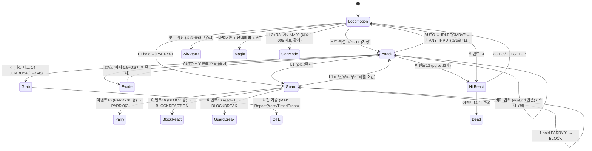

# 10. 전투 시스템 명세 (콤보 테이블 · 상태 기계 · 피해 · 신들의 분노 · 마법 · 적)

도구: `devple.gow.tools.combat` (`combat:*` 명령), 기존 `exe:*` / `tweak:*`
근거: `work/exe/SCKA.asm`(자체 R5900 디스어셈블리), `work/exe/twk/*.txt`(TWK 덤프), `work/combat/*`(이번 단계 산출물)

신뢰도: **[확실]** = 디스어셈블/데이터 대조로 직접 확인, **[추정]** = 호출 맥락·이름·데이터 분포로 판단.
주소는 EE 가상 주소. 이 문서에서 새로 붙인 함수 이름은 §14 에만 있고 `exe/names.txt` 에는 넣지 않았다.

---

## 0. 요약

- **전투는 완전히 데이터 구동**이다. 플레이어와 모든 적이 같은 엔진(`Combat_*`, 0x2027xx–0x209xxx)을 쓰고, 행동은
  `TWK_CombatFile_NNN` 바이너리(태그 0x72)의 **기술(Move) → 분기(Branch) 그래프**로 정의된다.
  - 기술 = 애니 1개 + 분기 목록 + 공격 판정 구간 + 애니 이벤트.
  - 분기 = "현재 애니 진행률이 [a,b] 구간이고, 입력/이벤트 X 가 들어왔고, 조건(지상/공중, 무기 레벨, 신 모드, 상대 종류·HP …)이 맞으면 → 기술 Y 로".
  - 입력 버퍼: 분기의 즉시 비트가 없으면 **입력을 저장했다가 구간 끝(winEnd) 시점에 실행** → 콤보 연결점. 즉시 비트가 있으면 바로 캔슬.
  - 피격·방어·사망도 같은 그래프의 **이벤트 분기**(코드 13/14/16/17/21/22)로 처리된다.
- 영웅 기술 테이블 7개(R_PERMK `TWK_CombatFile_000..006`, 기술 387개)를 **필드 전부 해석**하고 파서/덤프/콤보 트리 도구를 만들었다.
- **피해 공식** [확실]: `피해 = 공격.damage(정수) × 공격자 배율`,
  플레이어 배율 = `난이도.DamageMult × 코스튬.DamageMult × (신모드 ? 무기레벨.GodModeDmgMult : 1) × (아르테미스 ? 검단계배율 : 무기레벨.DmgMult)` (0x1DBD18).
- **신들의 분노**: L3+R3, 게이지 0–100, ≥99 에서 발동, 초당 7.0715 감소(≈14초), ≤1 에서 해제. 공격이 맞을 때마다 기술별 이벤트로 +0.15(대부분) 충전.
- 적 89종(AI1 템플릿)의 HP·피해 배율·방어 확률·잡기 원 HP 를 표로 뽑았다(§13). 적 클래스는 C++ 클래스 하나(`Enemy1`)이고 차이는 전부 데이터.

---

## 1. 도구 / 산출물

```
./gradlew :tools:run --args="combat:dump gow-rom/R_PERMK.WAD work/combat/combat_R_PERMK.txt"   # 기술·분기·공격·이벤트 전부
./gradlew :tools:run --args="combat:tree gow-rom/R_PERMK.WAD ROOT 6 normal"                     # 콤보 트리 (normal|god|berserk|air|all)
./gradlew :tools:run --args="combat:tree gow-rom/R_PERMK.WAD COMBO3A 3 all"                     # 특정 기술부터
./gradlew :tools:run --args="combat:enemies gow-rom work/combat/enemies.md"                     # 적 표 (§13)
```

| 클래스 | 역할 |
|-------|------|
| `combat.CombatFile` | 0x72 블록 파서. `Move / Branch / Attack / Event` 레코드, half-float 변환, 코드 이름표 |
| `combat.Cli` | `dump / tree / enemies`. 애니 이름은 TWK 사전(`_Tween/_Cycle` 제거) + WAD 내 식별자 문자열을 `Hash127Upper` 로 대조해 복원(영웅 387개 기술 전부 복원) |

덤프 표기: `> [0.27-1.00]! SQUARE/press -> M87 COMBO4A @0.33  f=108243 lv>=1`
= 진행률 0.27–1.00 에서 □ 누름 → 기술 87(COMBO4A)을 애니 0.33 지점부터, `!` = 즉시(버퍼 없음), `f` = 분기 플래그, `lv` = 필요 무기 레벨.
`! [..] dmg=` 는 공격 판정, `* [..]` 는 애니 이벤트.

산출물(`work/combat/`, git 제외): `combat_R_PERMK.txt`(9,100행), `combat_R_MIN.txt`, `combat_R_SKS.txt`, `tree_{normal,god,berserk,air}.txt`, `enemies.md`.

---

## 2. CombatFile 바이너리 포맷 [확실]

### 2.1 컨테이너
WAD 태그 0x72(`Tag_TweakRef` 0x17EC48): `u32 1`, `cstr "/TweakTemplates/CombatFile/NNN/"`, 이후 블록. (`TWK_Sold_NNN` 도 같은 태그지만 다른 고정 구조체.)

| 블록 오프셋 | 형 | 내용 | 근거 |
|---|---|---|---|
| 0x00 | u16 | 기술 수 | 0x209F90 (`lw 0(s1)` 반복 한계) |
| 0x02 | u16 | 루트 액션 수 | 0x2027E8 |
| 0x04 | u16 | 루트 액션 표 오프셋(블록+4 기준) | 0x2027E8 `lhu 4; addu; addiu 4` |
| 0x06 | u16 | (0x04 와 같은 값, 미사용) | |
| 0x08 | Move[n] | 0x18 바이트, **ID 오름차순** | 0x209F58 (`id*0x18`), 0x209F90 조기 종료 |
| 4+off | {u16 rel, u16 id}[m] | 루트 액션 → Branch (rel 은 항목 자신 기준) | 0x2027E8 |

모든 하위 목록 항목은 `{u16 relOff(항목 자신 기준), u16 index}` 4바이트이고, 여러 기술이 같은 분기/이벤트 레코드를 공유한다(중복 제거된 풀).
진행률 값은 모두 `u16/65535` (0x477FFF00 = 65535.0 으로 나눔), 실수 파라미터는 half-float(아래).

**half-float** (0x209700 등): `bits = ((h&0x7FFF)<<13) | ((h&0x8000)<<16); f = asFloat(bits) × 2^112`. 0x3C00 = 1.0.

### 2.2 Move (기술, 0x18)
| 오프셋 | 형 | 필드 | 의미 / 근거 |
|---|---|---|---|
| 0x00 | u32 | animHash | 애니 이름 `Hash127Upper` → `sub_001f7b98` 로 애니 조회 (0x209604) [확실] |
| 0x04 | u16 | id | 전역 ID. 파일별 대역: 000=0–49, 004=50–99, 001=100–199, 002=200–499, 003=500–599, 005=700–799, 006=800–899 |
| 0x06 | u16 | → 분기 목록 (기술 기준 상대) | 개수 = +0x14 (0x209128) |
| 0x08 | u16 | → 공격 목록 | 개수 = +0x15 (0x209D70, 0x209B08) |
| 0x0A | u16 | → 이벤트 목록 | 개수 = +0x16 (0x2061D4) |
| 0x0C | half | 재생 속도 | `sub_001f6fc8(f12)` 인자 (0x209718). 대부분 1.0, COMBO4B 1.5 [추정: 속도] |
| 0x0E | u16 | flags | 0x2: 공격이 방어 불가(가드 브레이크) + 피격자 경직 무시 (0x204110, 0x20374C) / 0x4: 경직 무시 / 0x8, 0x20, 0x40: 락온·카메라 대상 처리(0x209790) [0x2/0x4 확실, 나머지 추정] |
| 0x10 | s16 | poise | 이 기술 중 받은 누적 피해 ≤ poise 이면 피격 반응 없음. **-1 = 슈퍼아머** (0x203764) [확실] |
| 0x12 | u8 | stateMask | 1/3/7 [미상] |
| 0x13 | u8 | guard | **1 = 방어 자세**(BLOCK, BLOCKREACTION, PARRY01), 2 = 피격 경직 중 (0x2040E4 `lb 0x13; ==1`) [1 확실] |
| 0x14–0x16 | u8×3 | 분기/공격/이벤트 수 | |

### 2.3 Branch (분기, 0x24) — `sub_00208578` 이 매칭
| 오프셋 | 형 | 필드 | 의미 |
|---|---|---|---|
| 0x00 | u32 | flags | §2.4 |
| 0x04 | u16 | winStart | 현재 애니 진행률 하한 (0x2088C4) |
| 0x06 | s16 | target | 다음 기술 ID. -1 = 현재 기술만 종료(→대기), -2 = 아무것도 안 함(다른 분기 차단) (0x2094F0, 0x209400) |
| 0x08 | u16 | winEnd | 상한. 버퍼 분기의 실행 시점 (0x208E68) |
| 0x0A | u16 | startPhase | 다음 애니 시작 위치 (0x209590) |
| 0x0C/0x0E | s16 | 상대 HP 범위 | 입력 폴링: 락온 타깃 HP(0x207D88), 이벤트: 공격자 HP. 기본 0..0x7FFF |
| 0x10/0x12 | s16 | 자신 HP 범위 | owner+0x178 (0x208944) |
| 0x14 | s16 | 자신 종류 | owner+0x1B0 객체 가상슬롯3 (0x208A24) = 0x244AF8 `AI+0x24 → +0x9C` = AI1 템플릿의 종류 필드 (해시 0x247B, 로더 0x18BE24) [확실]. -1 무시 |
| 0x16 | s16 | 상대 종류 | 같은 종류 번호 (예 250 = 히드라 보스, 영웅 0). **AI1 번호가 아니다** — 변종 템플릿은 기본 종류를 가리킨다: R_MI2 51·R_MI4 53·R_MI5 54·R_MIF 55 → 50, R_SKA 31·32 → 20, R_SKB 24 → 25, R_SKF 25 → 26, R_SKD 37 → 24, 시민 301·313 → 280, 아기 히드라 258 → 253, 분신 667–669 → 666 (디스크 AI1 92 개 중 31 개, R_AH* 254–256 은 필드 없음) [확실: 데이터] |
| 0x18 | s16 | 상대 자세 태그 | 상대 combatant+0x1B0 (이벤트 20 이 설정, 매 프레임 0x2061C8 이 0 으로 지움, 상대 없음 = −2 — 0x207CB0). flags 0x4000 이면 **부정** ("≠ 이 값") [확실: 0x2089B4–0x208A04] |
| 0x1A | s16 | (항상 -1 로 호출) | |
| 0x1C | s8 | input | §2.5 |
| 0x1D | s8 | mode | 1 누름(엣지) 2 뗌 3 기술 시작부터 계속 누름 4 누르고 있음 5 안 누름 (점프표 0x2B9270) |
| 0x1E | s8 | dir | §2.6 |
| 0x1F | s8 | magic | 0 무관, 3–6 = 선택 마법이 이것이고 MP 충분해야 함(부족하면 `SND_IG_MAGICOUT`), 7 = 아르테미스의 검 보유(0x3044C2&0x40) (0x208174) |
| 0x20 | s8 | reaction | 이벤트 분기: 공격의 반응 종류와 일치(-1 무시) |
| 0x21 | s8 | level | **필요 무기 레벨** ≤ 0x3044BD (0x2086B0) |
| 0x22–0x23 | | 패딩 | |

일치 점수: -1(와일드카드)로 통과한 항목마다 비트를 더해(0x1A→1, 0x20→2, 0x18→4, 0x16→8, 0x14→0x10) **점수가 가장 낮은(가장 구체적인) 분기**를 고르고, 동점이면 난수(0x13E6B0)로 고른다. [확실]

### 2.4 Branch.flags [확실 — 0x208578]
| 비트 | 의미 |
|---|---|
| 0x1 | **즉시 실행**(캔슬). 없으면 입력을 큐에 넣고 애니가 winEnd 에 도달하면 실행 |
| 0x2 / 0x4 / 0x20 / 0x80 / 0x10000 | 허용 상태: 지상 / 공중 / 벽(매달림) / 로프 / 수영. owner+0x174 → `sub_00207dc0` 상태 마스크와 AND |
| 0x8 | combatant.0x1AC&0x1000 필요, 실행 시 소비 (설정: SCR_TriggerMedusaHead — 메두사 Nuke 가능, 35 문서 §2) |
| 0x10, 0x40 | 0x40 = 잡기 조건 무시. 없으면 +0x1B8(잡기 가능) 이 (0x10 ? 참 : 거짓) 이어야 함. 누구의 +0x1B8 인지 (0x208800): 플레이어 (owner+0x174 < 0) 는 타깃 (+0x80 핸들), 그 밖 (적·보스) 은 **자기 owner (+0x48)** — 적 피격 반응이 자기 잡기 가능 여부로 갈린다 (미노타우로스 GRAB 태그 200: 400 MAIMIN01 0x148212 / 3 blockShove 0x148202) |
| 0x100 / 0x200 | 0x100 = **신 모드 중에만**, 0x200 = 무관, 둘 다 없음 = 신 모드가 아닐 때만 |
| 0x400 | 락온 타깃 필요 |
| 0x800 | 차지 완료(combatant.0x1AC&0x400, 이벤트 33) 필요, 실행 시 소비 |
| 0x1000 | 입력 우선순위 최고(4) |
| 0x2000 / 0x8000 | 0x2000 = **아르테미스의 검 장착 중에만**(player.flags&0x20), 0x8000 = 무관, 둘 다 없음 = 미장착일 때만 |
| 0x20000 / 0x40000 | player.flags&0x8 필요 / 무관 / (없음) 불가 [플래그 의미 미상] |
| 0x80000 / 0x100000 | player.flags&0x10 필요 / 무관 / 불가 [미상] |
| 0x4000 | +0x18 자세 태그 **부정**: 태그가 같으면 실패, 다르면 통과 (−1 이면 무관) [확실: 0x2089B4–0x208A04]. 예 영웅 GRAB 의 GRABREJECT `tgt=251 tag=830 0x10c247` = "선창 히드라가 기절 태그 830 이 아닐 때", 같은 점수의 830 BHAENC1GRAB `tag=830 0x109247` 과 겹치지 않는다 (37 §4.3). 예전 엔진은 "태그 무시" 로 읽어 동점 난수로 갈렸다 |

영웅 기본 분기 `0x108242` = 지상 + 타깃 무시 + 신모드 무관 + 검 무관. 루트 액션 `0x100042` = 신 모드가 **아닐 때만** → 신 모드 전용 세트(파일 005)는 `0x100142`.

### 2.5 입력/이벤트 코드 (+0x1C) [확실]
1–10 은 패드 비트(코드→비트 표 0x2C2238), 11 이상은 폴링 점프표 0x2B9290 또는 이벤트 호출 인자.

| 코드 | 패드 비트 | 버튼 | 비고 |
|---|---|---|---|
| 1 | 6 | × | 점프 (전투 중 COMBOJUMP 등) |
| 2 | 7 | □ | 약공 |
| 3 | 4 | △ | 강공 |
| 4 | 5 | ○ | 잡기 |
| 5 | 2 | L1 | 방어 |
| 6 | 0 | L2 | **마법** — 항상 +0x1F 마법 ID 와 함께 쓰임 [확실: Pad_Read 비트 순서, §16] |
| 7 | 9 | L3 | 미사용(영웅) |
| 8 | 3 | R1 | DASH / BRUTAL3 / 공중 AIRDASH |
| 9 | 1 | R2 | 미사용(영웅) — '사용' 버튼 (상자·문·레버, 38 §3.4) |
| 10 | 10 | R3 | 미사용 |
| 11 | – | AUTO | 무조건 참 → winEnd 에서 자동 연결(애니 끝 처리) |
| 12 | – | ANY_INPUT | 새 버튼(비트 0–7) 또는 스틱 > 0.5 |
| 13 | – | 이벤트: 피격 반응 | `sub_00204458` → 피격자 |
| 14 | – | 이벤트: 사망 | HP≤0 (0x209054), 치명타. 0x208A98 끝 (0x209024): 분기 큐 (+0x1C5) 가 비어 있고 owner HP ≤ 0 이면 **매 프레임** 맞춘다 — 죽던 기술의 EV_DEATH 가 (block) 이면 기술이 끝난 뒤 루트 액션 EV_DEATH 로 이어짐 [확실: 코드] (엔진: 기술 끝에 한 번, 37 §4.3) |
| 16 | – | 이벤트: 공격을 막아냄 | 피격자(방어 중) |
| 17 | – | 이벤트: 내 공격 적중 / 폴링: 이번 프레임 적중(mode 4 = 이번 기술 중 1회 이상) | 공격자 |
| 18 | – | SYNC | 상대와 같은 기술 동기화(잡기 연출) |
| 19 | – | STICK | 스틱 > 0.5 |
| 20 | – | LANDED | 착지 |
| 21 | – | 이벤트: 잡기 원 임계 HP 통과 | `sub_00204458` (flag 4) |
| 22 | – | 이벤트/폴링: 내 공격이 막힘 | 공격자 |
| 0, 15 | – | 폴링 불가 — ID 로 직접 요청(AI/스크립트 `sub_00209378`) 전용 | |

패드 워드 = `((buf[0]<<8)|buf[1]) ^ 0xFFFF` (Pad_Read 0x17C370) → 비트 0–7 = L2 R2 L1 R1 △ ○ × □, 8–15 = SELECT L3 R3 START ↑ → ↓ ←.

### 2.6 방향 조건 (+0x1E, 점프표 0x2B92F0) [확실]
| 값 | 조건 |
|---|---|
| 0 | 없음 |
| 1 / 2 | 왼쪽 스틱 크기 < 0.8 (중립) / ≥ 0.8 |
| 3 / 4 / 5 / 6 | 왼쪽 스틱 ≥0.8 이고 캐릭터 기준 좌 / 우 / 앞 / 뒤 (내적 ≥ 0.7071 = 45°) |
| 7 / 8 / 15 | player+0x50 > 2 / 4 / 15 = **스틱 흔들기 게이지** (sub_001D8B98: 두 스틱 |Δ|·0.2·(1+0.6·(1−|스틱|)) 누적 − /Player/ "Wiggle Meter Drain" 2.0/초, 기술 시작 시 0) [확실] — 분신 잡기 861 "fall>2" 탈출 (37 §9) |
| 9–14 | 오른쪽 스틱판 1–6 (단 옵션 0x29F16C+4 == 1 일 때) — **회피(구르기)** 는 `AUTO + RS-방향(11–14)` 분기 |

### 2.7 Attack (공격 판정, 0x20) [확실 — 0x209AB0, 0x2032C0, 0x204458]
| 오프셋 | 형 | 필드 |
|---|---|---|
| 0x00 | half[3] | 지상 피격 충격 벡터 (x, y, z) — 피격자 지상일 때 `sub_002039e0` |
| 0x06 | half[3] | 공중 피격 충격 벡터 |
| 0x0C | half[3] | 방어 시 밀어내기 벡터 (보통 (0,0,1000)) — 방어 자세면 방어 불가 공격이어도 적용 (§7.2) [확실: 0x204164] |
| 0x12/0x14 | u16 | 판정 시작/끝 진행률 |
| 0x16 | s16 | MFX 템플릿(재질별 타격 이펙트·사운드, flags&2) 예 520 |
| 0x18 | s8 | 판정 부위 인덱스(무기/히트박스 번호와 일치해야 함) |
| 0x19 | s8 | **기본 피해** |
| 0x1A | u8 | 0x1 락온 타깃만 맞음, 0x2 MFX, 0x4 밀어내기 방향 = 공격자 정면 − 0.3·(피격자 쪽) (0x204044, §7.1), 0x8 같은 편도 맞음 (0x203798) |
| 0x1B | s8 | 막혔을 때 반응 종류(이벤트 16 인자, 1 = 가드 브레이크 → BLOCKBREAK) |
| 0x1C | s8 | 피격 반응 종류(이벤트 13/21 인자) |
| 0x1D | s8 | 사망 종류(이벤트 14 인자) |

같은 판정 구간은 같은 상대를 한 번만 때린다(combatant+0xAC 의 (상대, 구간) 쌍 최대 32개, 기술 시작 시 초기화 0x209C78).
벡터 성분 순서 (x=좌우, y=상하, z=전후) 는 [추정] — COMBO7A (0,-3000,500) 는 내려찍기, 띄우기 기술은 y>0.

### 2.8 Event (애니 이벤트, 0x14) [확실 — 0x206030]
| 오프셋 | 형 | 필드 |
|---|---|---|
| 0x00 | u32 | 이름 해시 (사운드 `SND_*`, 조인트 `LMETATARSAL`, 스크립트 이벤트 …). 0x001349E0 = "없음" |
| 0x04 / 0x06 | half | 파라미터 a / b |
| 0x08 / 0x0A | u16 | 발동 구간 |
| 0x0C | s16 | 템플릿 인덱스 (CameraShake/ForceFeedback/PlayFX 등) |
| 0x0E | s8 | 발동 확률 % |
| 0x0F | s8 | 종류 (아래) |
| 0x10 | s8 | 조건 (§7.4, 직전 프레임의 접촉 기록으로): 0 항상(1회) 1 내 공격 적중 프레임마다 2 적중(1회) 3 처치 4 플레이어에게 적중 5 막힘 6 사망 (자기 HP ≤ 0 일 때만 — 메두사 여왕 피격 동작 hitLand·hitBounce·hitLaunch 의 SCR_ExplodeDeath 가 6, 사망·머리 뜯기 동작의 것은 0 [데이터]) |
| 0x11 | s8 | 필요 무기 레벨 |
| 0x12 | u8 | 0x1 무기 레벨별 템플릿, 0x2 거리 조건 |

종류(+0x0F, 점프표 0x2B91B0) — 재구현에 중요한 것만:

| 값 | 이름 | 동작 | 신뢰도 |
|---|---|---|---|
| 3 / 40 | SOUND | 사운드 재생 (hash) | 확실 |
| 5 / 6 | CAMERA_SHAKE / FORCE_FEEDBACK | 플레이어만, idx = 템플릿 | 확실 |
| 9 | **INVULNERABLE** | combatant.0x1AC \|= 2 → 구간 동안 피격 무시 | 확실 |
| 12 | NO_BLOCK | 0x1AC \|= 0x40 — 창 안에서만 (매 프레임 비트 초기화 0x2061AC). OnContact 0x2040FC·0x203248·투사체 0x190ED4 가 AI 자동 방어를 묻지 않음 (§7.5) | 확실 |
| 14 | ANIM_SPEED | 재생 속도 목표 b, 지속 a초 (0x2059C0 에서 0.1 비율로 보간) | 확실 |
| 17 / 18 | TRAIL_LEFT / RIGHT | 블레이드 트레일 | 확실(CombatFileSet "Trail Left/Right" 와 같은 비트) |
| 20 | SET_1B0 | **공격 자세 태그** = idx (피격자의 반응 분기 +0x18 이 이것을 봄) | 확실 |
| 21 | **GOD_METER_ADD** | 신 게이지 += b (0x1DB4F8) | 확실 |
| 24 | **HIT_PAUSE** | 이 기술이 맞추면 a초 히트스톱(ms 메시지 0x414 를 양쪽에) | 확실 |
| 25 | HIT_COUNT | 히트 카운터 +1 | 확실 |
| 26 / 27 | CIRCLE_OFF / ON | 잡기 원(goMiniGameCircle) 표시 | 확실 |
| 33 | CHARGE_CHECK | combatant.0x1B4 ≥ a → 0x1AC\|=0x400 (차지 완료). 0x1B4 = 현재 기술 플래그 0x100 인 동안 프레임마다 +1/60, 아니면 0 (0x207108) — 버튼이 아니라 "그 상태로 있은 시간" | 확실 |
| 39 | BONUS | 히트 수 ≥ 마일스톤 → 보너스 템플릿 | 추정 |
| 41–47 | ATTACH_ON/OFF | 조인트 부착물(발자국/먼지 FX) | 추정 |
| 48 | CONCUSSION | 충격파(넉백) 템플릿 | 추정 |
| 0 | (무효) | | 확실 |

---

## 3. 런타임 구조

### 3.1 Combatant (엔티티별 전투 컴포넌트) [확실 — 0x209488, 0x208A98, 0x206030]
| 오프셋 | 의미 |
|---|---|
| +0x2C/+0x30/+0x34 | 재생 속도 현재/목표/남은 시간 (이벤트 14) |
| +0x3C | CombatFileSet* (파일 최대 8개, set+0x48) |
| +0x44 | 히트스톱 이벤트 포인터 (이벤트 24) |
| +0x48 | owner 엔티티 (HP = owner+0x178, 최대 HP = +0x17C, 상태 비트 = +0x174) |
| +0x4C / +0x54 / +0x58 | 현재 분기 / 현재 기술 / 기술 ID (-1 = 없음) |
| +0x5C | 애니 재생 핸들 (진행률 = t/len, 0x209D1C) |
| +0x64 | 이번 기술 중 받은 누적 피해 (경직 판정) |
| +0x70 (u64) | 분기별 "시작부터 누름" 추적 비트 (기술 시작 시 하위 32비트 1) |
| +0x78 (u64) | 이벤트 발동 비트 |
| +0x80 | 락온 타깃 핸들 |
| +0x9C/+0x9D/+0x9E, +0xA0/+0xA4/+0xA8 | 처치/적중/막힘 횟수와 마지막 프레임 |
| +0xAC.. | (상대, 공격구간) 적중 기록 32개 |
| +0x1AC | 상태 비트: 0x2 무적, 0x8/0x10 트레일, 0x40 방어불가, 0x400 차지 완료, 0x1000 … (기술 끝날 때 CombatFileSet+0x34 값으로 복원) |
| +0x1B0 | 공격 자세 태그(이벤트 20) |
| +0x1B4 | 차지 시간: 기술 플래그 0x100 인 동안 누적 (HITLIE 0x190 반복 중에도 이어짐) |
| +0x1C0 | 분기 큐(링 버퍼: 포인터, +4 용량, +5 대기 인덱스, +6 쓰기) — **입력 버퍼** |

### 3.2 CombatFileSet 템플릿 (0x202868) [확실]
`/TweakTemplates/CombatFileSet/NNN/`: `File 0..7`(short, -1 = 없음), `Invulnerable`(0x595AD8AD), `Trail Left/Right`, `Reticle Scale`, `Target Weight`, `Circle Scale` 등.
충격 배율 (밀어내기·넉백 0x203890, §7.2): #35f40b1b → +0x3C (옆 x), #7a4a8930 → +0x40 (위 y), #df4375e3 → +0x44 (앞 z). +0x34 기본 상태 비트: #4e16ee9c 0x1, Invulnerable 0x2, Trail Left 0x8, Trail Right 0x10, #ee25120b 0x2000 [확실: 0x202940–0x202A1C].
영웅 = Set 000 "Hero": File 0–6 = CombatFile 000–006.

| 파일 | ID | 내용 |
|---|---|---|
| 000 | 0–49 | 블레이드 특수기: COMBO7A(□□△ 계열), BLOCK360/BLOCKFORWARDFLIP/BLOCKLAUNCHER(L1+버튼), DASH, 공중기, BLOCK, PARRY01, BRUTAL1/3, WALLJAB* |
| 004 | 50–99 | 기본 콤보 COMBO3A–3F/4A–4D, 공중 방어, 로프/벽 공격, 메두사·제우스 마법 기술, IDLECOMBAT |
| 001 | 100–199 | 영웅 피격 반응(HITLEFT…HITKNOCKDOWN, PARRYHIT, FREEZE, DEATH, 일어서기) |
| 002 | 200–499 | 잡기/처형/미니게임(MAI*), 적별 동기 연출 |
| 003 | 500–599 | 회피 EVADE*, 벽점프, 번개·하데스 마법, **아르테미스의 검(BER*)** |
| 005 | 700–799 | **신들의 분노(God Mode) 전용 콤보** |
| 006 | 800–899 | 보스(히드라 BHA*, 침대 XPT, EVI) 전용 상호작용 |

---

## 4. 상태 기계와 입력 처리

### 4.1 상태 구성
엔진에는 "공격 상태" enum 이 따로 없다. **상태 = (기술 없음 | 현재 기술 ID)** 이고, 이동·점프·대기 애니는 별도의 이동 시스템
(`/Animation/goHero/Navigation/Bank N`, docs/06 §8.2)이 담당한다. 전투 그래프는 "기술 없음" 일 때 모든 파일의 **루트 액션**을 평가한다.



### 4.2 매 프레임 처리 (`Combat_Update` 0x205968 → `Combat_PollInput` 0x208A98) [확실]
```
input = (owner+0x174 < 0) ? g_player->pad : null      // AI 는 입력 없음, sub_00209378 로 액션 ID 를 직접 요청
if (현재 기술 있음):
    t = clamp(animTime/animLen, 0, 1)
    for 분기 b in 현재기술.branches:
        if !(b.winStart <= t <= b.winEnd): continue
        if !InputOK(b, input) (0x207E40): holdMask &= ~bit(b.index); continue
        if !Match(b) (0x208578): continue
        prio = (b.input==AUTO) ? 1 : (b.mode==3 ? (holdMask&bit ? 2 : -1) : 3)
        if (b.flags & 0x1000) && prio != -1: prio = 4
        가장 높은 prio 후보들 수집(동률 = 난수 선택)
    if 큐 대기 분기가 있고 그 prio >= 새 prio: 새 후보 버림
    선택 분기 c:
        execAt = (c.flags & 1) ? 0 : c.winEnd
        if execAt > t and (c.input==AUTO or c.mode==3): 큐에 넣지 않음(나중에 다시 평가)
        else 큐에 (c, execAt) push
else:   // 기술 없음
    if input 있음: 모든 파일의 루트 액션을 Match → 점수 최저 후보(동률 난수) → 큐에 (c, 1.0)
if owner.HP <= 0 and 큐 비었음: 이벤트 14(사망) 분기 → 큐
큐 처리: 애니 진행률 >= execAt 인 항목을 `Combat_StartBranch`(0x209488)
```
- **입력 버퍼링** = 큐(+0x1C0). 버퍼 분기(즉시 비트 없음)는 창 안에서 누르면 winEnd 까지 대기 후 실행 → 데이터의 "버퍼 구간 [0, X] + 즉시 구간 [X, 1]" 쌍이 표준 패턴이다(예: COMBO3A □ → [0–0.27] 버퍼, [0.27–1.0] 즉시 → **연결점 0.27**).
- **우선순위**: AUTO(1) < 시작부터 홀드(2) < 일반 버튼(3) < 0x1000 분기(4). 이미 큐에 있는 분기보다 높아야 교체.

### 4.3 분기 실행 `Combat_StartBranch` 0x209488 [확실]
1. 현재 기술 종료(`sub_00209918`: 0x1AC 를 Set 기본값으로 복원, 적중 기록 초기화, 기술 끝 메시지 0x417).
2. 분기 flags 0x800/0x8 → 차지/플래그 소비.
3. target == -1 이면 끝(기술 없음 상태로). 아니면 기술 조회(파일 8개 순회, 0x202C08).
4. 애니 시작: `sub_001f6fc8(anim, startPhase, speed)`; input==SYNC(18) 이면 상대 애니 진행률을 시작점으로.
5. 기술 flags 0x20/0x40 → 락온 타깃 갱신, 메시지 0x40B(기술 시작) 발송, 이벤트 처리기 즉시 1회 실행(0x206030).

### 4.4 영웅 주요 콤보 (지상, 신모드·검 아님; `combat:tree ROOT normal`) [확실: 데이터]
| 입력 | 기술 (ID) | 판정 피해 | 연결점 / 조건 |
|---|---|---|---|
| □ | COMBO3A (71) | 2 | 다음 □ 연결 0.27 |
| □□ | COMBO3B (72) | 2 | 0.35 |
| □□□ | COMBO3C (73) | 2 | 0.47 |
| □□□□ | COMBO3D (74) | 3+3 | 0.37 |
| □□□□□ | COMBO3E (75) | 3+3 | |
| □□△ | COMBO7A (3) | 0 (+충격 y=-3000) | 내려찍기 계열 |
| △ | COMBO6A (32) | 6+6 | 다음 연결 0.75 |
| △△ | COMBO3E (75) | 3+3 | 무기 레벨 ≥2 |
| △△△ | COMBO3F (76) | 3 | |
| △△□ | BRUTAL1 (47) | 0+10 | 0.45 |
| R1 | DASH (6) | 4 | 무기 레벨 ≥1. DASH→R1 = BRUTAL3 (≥3) |
| ○ | GRAB (200) / 타깃 태그 14 이면 COMBO5A (22) | – | 잡기 원이 뜬 적 |
| L1(hold) | PARRY01 (48) → BLOCK (33) | | |
| L1+□ | BLOCK360 (2) | 1×10 | ≥2 (회전 베기) |
| L1+△ | BLOCKFORWARDFLIP (4) | 1×6 | ≥3, 시작 0–0.2 무적 |
| L1+× | BLOCKLAUNCHER (7) | 4 | ≥1 (띄우기) |
| L1+○ | IMPALESLAMCHARGE (23) | – | ≥4 (차지) |
| L1+R1 | BERSERKENTER (555) | – | 아르테미스의 검 보유 시 무기 전환 |
| 오른쪽 스틱 | EVADEFRONT/BACK/LEFT/RIGHT (514–517) | – | 즉시, **0–0.20 무적**, 0.5/0.6 이후 □△ 즉시 |
| 공중 □ / △ / R1 / ○ / L1 | AIRH1 (13) / AIRV1 (11) / AIRDASH (16, ≥1) / AIRTHROWMISS (203) / AIRBLOCK (77) | 2 / 2+2 / 4 | |

신들의 분노(파일 005): □ COMBO4A(700, 7) → □ COMBO4B(2+2) / △ COMBOLR4(4×3) …, △ COMBOLR4 → △ COMBOLR2(5×3), △홀드 COMBO4D(6+14), R1 BRUTAL3(4).
아르테미스의 검(파일 003, flags 0x2000): □ BERCOMBOH1(5), △ BERCOMBOV1(5), ○ BERCOMBOH3(10), R1 BERCOMBOSTAB(4×5), 공중 □/○/△ = 5/10/10.

---

## 5. 히트 판정과 피해

### 5.1 접촉 처리 `Combat_OnContact` 0x203AF0 [확실]
1. 공격자 현재 기술의 공격 구간 중 (부위 일치, 진행률 ∈ [start,end], 같은 상대에게 아직 안 맞음) 인 것을 찾음(0x209AB0). flags&1 이면 락온 타깃만.
2. 피격자 0x1AC&2(**무적**) 이거나 전역 정지(0x1BF108)면 무시.
3. **방어 판정**: 피격자 현재 기술 guard == 1 (또는 AI 자동 방어 `sub_00203248`/BlockMod) 이고 공격자 기술 flags&2(방어 불가)가 아니면 **막힘**:
   - 피격자 밀어내기 = 공격.+0x0C 벡터, 피격자 이벤트 16(react = 공격.+0x1B), 공격자 이벤트 22. **피해 없음**. 각도 검사 없음 (뒤에서도 막음), 방어 불가여도 밀어내기는 먼저 — 자세한 것은 §7.
4. 막히지 않음(또는 가드 브레이크): `Combat_ApplyHit` 0x2032C0 → 피해·반응, 공격자 이벤트 17.

### 5.1a 부위(Attack.part)와 히트박스 [확실 — 0x13C400, 0x13AAA8, 0x139008, 0x203150, 0x1BED34]
- 판정 볼륨 = 오브젝트의 **CDV_ BallHull 구**(12 문서). 로더 `sub_00138FD0` 이 인스턴스에 표 포인터를 둔다: +0x4C 재질 엔트리, +0x50 ball별 관절, +0x54 ?, +0x58 ball별 재질 번호, +0x5C 구.
- 구 월드 위치 `sub_0013AAA8`: `center · M[joint]` (joint = +0x50 바이트, M = 소유 오브젝트 관절 행렬 +0x8C + joint×64, 관절 활성 비트 +0x64 가 꺼지면 무효), 반지름 × 행렬 첫 행 길이.
- 구 대 구 접촉 `sub_0013C400` → 전역 접촉 레코드 0x2C8F10: +0x24 오브젝트, +0x2C/+0x30 각 쪽 재질 엔트리 포인터, +0x34/+0x36 각 쪽 관절 번호.
- 접촉 메시지 `sub_00203150`: 재질 엔트리 + [0x337700] 의 값 = **PartType** (프로퍼티 "PartType" 를 0x1BED34 에서 등록, CDV 엔트리 +0x30). 오브젝트 flags(+0xF4)&0x200 이고 PartType 2 이면 3 으로 바꾼다(오른손 무기). 이 값이 상대 쪽 `Combat_OnContact` 의 t0 → `sub_00209AB0(…, part)` 가 `Attack.+0x18 == part` 비교.
- 무기 오브젝트(flags&0x300)는 OnContact 에서 부모(+0x18 = 크레토스)로 바뀐다 (0x203B50).

| PartType | 볼륨 (CDV 재질) | 쓰는 기술 |
|---|---|---|
| 1 | 몸 `BodyCollisionMat` (히어로 관절 4·1 / 미노타우로스 3·1) | DASH, AIRDASH, GRAB, BRUTAL3 |
| 2 / 3 | 블레이드 `weaponLeftMat` (CDV_MAIBlade, r 13.2) 왼손 / 오른손(flags 0x200) | COMBO3A–F, COMBO6A, BLOCK360, AIR* … / 미노타우로스 `LeftCollisionMat`(관절 26) = 2 |
| 7 | 히어로 `rightFootCollsionMat` (발 관절 56·60, r 6.8) | ROPEHOH* |
| 9 | 히어로 `extra1CollsionMat` (pelvis 기준 정면 z −20, r 27) | GRAB, BRUTAL1, IMPALE, PARRY02 (대부분 dmg 0) |
| 10 | (아르테미스의 검 — CDV 미확인) | BER* |
| 11 | 블레이드 `weaponTwinCollisionMat` (같은 구) | COMBO4C/4D, BRUTAL1/3, BLOCKFORWARDFLIP |
| 4/5/0 | 미확인 (영웅 1회씩, 미노타우로스 0) | |

블레이드 구는 `maiblade` 오브젝트 관절 0 로컬이고, 블레이드 오브젝트는 히어로 `lWeapOH`/`rWeapOH` (05 문서 2.8, 타입 10 위치) 에 붙는다. 구현 34 문서.

### 5.2 피해 `Combat_ApplyHit` 0x2032C0 [확실]
```
dmg = attack.damage × AttackerScale(attacker)          // 0x203720: lb 0x19 × sub_00209e58
victim.accum += dmg                                     // combatant+0x64
react = (attackerMove.flags & 6) || victim 현재기술 없음 || (victim.move.poise != -1 && accum > poise)
killed = victim.HP > 0 && victim.HP <= dmg
circle = victim.TakeDamage(dmg)                         // 0x1E1650: HP 감소, Circle HP 임계 통과 시 잡기 원 표시
메시지 0x40F(dmg, HP) 발송, 플레이어가 적을 때렸으면 HitCounter++ (0x1DB5B8)
히트스톱: attacker.+0x44(이벤트 24) 의 a × 1000 ms → 메시지 0x414 를 양쪽에
반환 비트: 2 = 반응, 1|2 = 처치, 4|2 = 잡기 원 임계
```
그 다음 `sub_00204458`: 처치 → 피격자 이벤트 14(death = 공격.+0x1D), 원 임계 → 이벤트 21, 그 외 → 이벤트 13(react = 공격.+0x1C).
이벤트 인자: 공격자 자세 태그(+0x1B0), 공격자 종류(AI1 번호), 공격자 HP. 넉백: 피격자 지상 → 공격.+0x00 벡터, 공중 → +0x06 벡터 (`sub_002039e0`).

### 5.3 공격자 배율

**플레이어** `Player_DamageScale` 0x1DBD18 [확실]:
```
m = Difficulty[g_difficulty(0x29DB54)].DamageMult            // 0x337728 + 12*d
  × Costume[costume(0x29D9F4→+0x1C4)].DamageMult            // 0x3042A0 + 32*c
if GodMode(player.flags&2): m ×= WeaponLevel[lv].GodModeDmgMult (=2.0)
if player.flags&0x20 (아르테미스의 검): m ×= Berserk[stage].DamageMultiplier (1.75/2.25/3.0)
else if !(player.flags&0x8):               m ×= WeaponLevel[lv].DmgMult (1/1.5/2/3/4/5)
lv = 0x3044BD (블레이드 레벨 0..5), WeaponLevel 표 = 0x3040C0 + 0x50*lv
```
**플레이어가 받는 피해** (환경/투사체 경로 0x1EADC0, 같은 패턴이 AI 공격 쪽에도 있음) [확실: 식 / 추정: 모든 경로 동일]:
```
m = Difficulty.AIDamageMult × Costume.AIDamageMult × (GodMode ? WeaponLevel[lv].GodModeEnmyDmgMult : 1)
```
적 기본 공격력 = 적 CombatFile 공격.damage × AI1 "Damage Multiplier"(대부분 1.0, 아레스/악몽 크라토스 2.0) × AI Damage Mult × 코스튬 AI Damage × (영웅 신 모드 ? GodModeEnmyDmgMult : 1) — 0x1D3E80 (AI vtable 0x2BB01C), 맞는 쪽이 누구든 (적끼리도) [확실].

| 표 | 값 |
|---|---|
| 난이도 Damage / AI Damage / AI Recovery | Easy 2.0/0.5/2.0, Normal 1/1/1, Hard 0.75/2.5/0.75, Impossible 0.5/5.0/0.5 |
| 무기 레벨 0–5 DmgMult | 1, 1.5, 2, 3, 4, 5 |
| GodModeDmgMult / GodModeEnmyDmgMult | (lv0 불가) 2.0 / 0.75, 0.6, 0.45, 0.3, 0.3 |
| 코스튬 0–5 Damage / AI Damage | 1/1, 1/1, 0.5/1, 2/4, 0.5/1, 2/0.25 |
| 아르테미스의 검 단계 0–2 | 1.75, 2.25, 3.0 |

### 난이도가 바꾸는 규칙 전부 [확실: g_difficulty u16 0x29DB54 읽는 15 곳, 표 0x337728 + d×0xC 읽는 7 곳]
방어·가드 확률, 경직/poise, 잡기·QTE 창·연타율, 무적 시간, 오브/체력 드롭, 보스 HP 는 난이도와 무관하다 (0x1E1428 의 0x337720 = Circle Sound Delay).

| 규칙 | 원작 | 값 (쉬움/보통/어려움/신) | 엔진 |
|---|---|---|---|
| 영웅이 주는 피해 | 0x1DBD18 | Damage Mult 2/1/0.75/0.5 | `DamageRules.playerScale` |
| 적이 주는 피해 | 0x1D3E80 | AI Damage Mult 0.5/1/2.5/5 | `EnemyFighter.setIncomingScale` |
| 공격 뒤 대기·재사용 대기 | 0x1CCCC8 / 0x1D3074, 잎 고르기 0x229258 | AI Recovery Time Mult 2/1/0.75/0.5 | `AiBrain` |
| 바닥 재질 피해 | 0x1EAC70 → 0x1EADC8 (1 초마다, 시트 "Damage"/"AIDamage" × AI Damage Mult × 코스튬 × 신 모드) | 예 PAND04J 10 → 초당 5/10/25/50 | `GameScene.surfaceDamage` [근사: 벽 면 없음] |
| 범위 피해 (SCR_ConcussionBurst) | 0x191720: 템플릿 "Damage" 하위 바이트 × 주인 배율 | 주인 배율 따라 | `MagicFx.concussionDamage` [근사: 한 번, 밀어내기 없음] |
| 쉬움으로 다시 하기 제안 | 0x1DBF90 ← 사망 메뉴 0x220360: 보통·어려움, 사망 수 % "Deaths Before Easy Offer"(5) == 0, Arena 아님 → DeadMenu_Event 3, 선택 → 0x29F484 → 체크포인트 로드 때 난이도 0 | – | `GameScene.openDeadMenu` (사망 메뉴 FLP DeadMenu: Choice 0 다시 / 1 나가기 / 2 쉬움으로) |
| 스크립트 변수 Internal 48 DifficultyLevel | 0x1AFF94 | OLYMP02 크레딧: 신만 Bonus24 | `GameScriptHost.difficulty` |
| 해금 비트 | 0x1B1168 | d0/1→1, d2→2, d3→4 | `Unlocks` |

배율이 붙지 않는 것: 마법 직접 피해 (포세이돈 번개 0x195718, 투사체 0x19D460), SELF_HP, CONCUSSION 이벤트 48, 스크립트 HEALTH.

예: Normal, 블레이드 lv3(DmgMult 3), COMBO6A(6) → 18. 미노타우르스 Lv1(HP 90)은 5타.

---

## 6. 피격 반응 · 경직 · 넉백 · 사망

- **반응 선택**은 피격자 CombatFile 의 이벤트 13 분기들을 §2.3 점수로 고른다. 일치 키 = (공격.react(+0x1C) ↔ 분기 +0x20, 공격자 자세 태그 ↔ +0x18, 공격자 종류 ↔ +0x16, 공격자 HP ↔ +0x0C..0E, 자신 HP ↔ +0x10..12, 지상/공중 플래그).
  - 예(해골병 R_SKS): 자세 태그 15 → HITSTAGGER, 18 → HITLAUNCH(띄움), 19 → HITBOUNCE, 16 → HITFRONT; 태그 무관 기본 → HITLEFT/RIGHT 계열.
  - 영웅 기술의 자세 태그(이벤트 20): DASH/BRUTAL3 = 1, BRUTAL1 = 2, AIRV1/COMBO6A/BLOCKLAUNCHERB = 3(띄우기), BLOCKLAUNCHER/COMBO4D = 4, COMBO7A = 5, BLOCKBACKFLIP = 6, 번개 = 14, 아르테미스 = 20, 잡기 = 200–236.
- **경직(poise)**: 피격자 기술 poise(+0x10) 보다 누적 피해(+0x64, 기술 시작 시 0)가 크면 반응. -1 = 슈퍼아머(영웅 BLOCK, COMBO5A 등). 공격자 기술 flags 0x2/0x4 는 poise 무시.
- **target -2 분기**("(block)")는 해당 이벤트에 반응하지 않게 막는 용도(예: 공격 중 피격 무시 구간).
- **사망**: HP ≤ 0 → 이벤트 14 분기(사망 애니 DEATH01/02, SWIMDIE…). 처치 시 OrbEmitter "XXX Death" 발동(§11).
- 영웅 피격 반응(파일 001): HITLEFT/RIGHT/BACK/FRONT(100–103), HITKNOCKDOWN(104), HITFIREBALL, HITLAND, HITBOUNCE, HITSPIN, HITAIR, HITLIE(**무적**), HITGETUP*(**무적**), FREEZEPOSE(메두사 석화, 무적), WALLHIT*.
- 충격파: Concussion 템플릿(`Ground/Air Impulse Away/Up/Right`, `Start/End Radius`, `Angle`, `Duration`, `Damage`) — 예 MI2_Slam: 반경 0→20, 30°, 1초, 충격 (1000, -3000, 0).

---

## 7. 방어 체계 (방어 · 패리 · 가드 브레이크 · 밀어내기 · 적 방어)

엔진 구현·검증은 26 문서 §10, 적 쪽 AI 는 17 문서 §7. 태그: [확실] = 디스어셈블·데이터로 확인, [추정] = 근거 있는 해석, [근사] = 엔진이 단순화.

### 7.1 접촉 한 번의 방어 판정 — `Combat_OnContact` 0x203AF0 [확실]
```
공격 판정 찾기 0x209AB0 (부위·진행률·같은 상대 1 회) → 없으면 끝
피격자 무적 (0x2441E0 비트 2) 또는 전역 정지 (0x1BF108) → 끝
d = 피격자 위치 − 공격자 위치                                   // 0x20402C (vsub)
if (공격 +0x1A & 4) d = 공격자 정면 (−행렬 2행) − 0.3·정규화(d)  // 0x204044 [확실: 식 / 추정: −2행 = 정면]
접촉 재질 +0x3376F0 비트 1 없으면 끝 (기록만)                    // 0x2040A8
기록 (상대, 공격) 0x209C50
guard = 피격자 현재 기술 +0x13 == 1                              // 0x2040DC
if (!guard && !(피격자 +0x1AC & 0x40 NO_BLOCK) && !(공격자 기술 flags & 2))
    if (0x203248(피격자, 공격자, 공격자 기술 ID)) guard = (새 기술 +0x13 == 1)   // AI 자동 방어 → 즉시 실행 0x205190
if (guard) {
    0x2039E0(피격자, d, 공격 +0x0C)          // 방어 밀어내기 — 방어 불가여도 먼저
    if (공격자 기술 flags & 2) → ApplyHit 0x2032C0 (피해·반응·넉백, 공격자 이벤트 17)   // 방어 불가
    else {
        피격자 이벤트 16 (인자 = 공격 +0x1B, 공격자 자세 태그·종류·HP)    // 0x20426C
        공격자 +0x9E 막힘 수 ++, +0xA8 = 이번 프레임 (0x209CA0)
        공격자 이벤트 22 (상대 = 피격자)                                    // 0x2042E4
        피해 없음, 히트스톱 없음 (0x203688 은 ApplyHit 안), 반환 0
    }
} else ApplyHit → 반응 이벤트 (13/14/21) + 넉백 0x204458, 공격자 이벤트 17
```
- **방향 검사 없음**: 각도·정면 판정이 없다. 방어 자세면 뒤·옆에서 온 공격도 막는다 (360°) [확실: 0x203AF0 전체에 방향 비교 없음].
- **깎이는 피해 (chip) 없음**: 막힌 공격은 피해 0 [확실].
- **방어 불가** = 공격자 **기술** flags & 2 (공격 판정이 아니라 기술 단위). 데이터 (전 WAD 조사): 사이클롭스 공격 전부 (ATTACKSWIPE·SLAM·FOOTSMASH·CY2SWIPE·SHOULDERRAM·TRIPLESMASH …), 세이렌 SIRSCREAM, 해골 WALLLEAP·ROPELEAP, 히드라 보스 물기·내려치기 (BHABOSS*), 켄타우로스 궁수 LEAPATTACK; 영웅 GRAB 200·COMBO5A 22 (○, 0x106)·공중 잡기·처형 MAISKB*·**신 모드 700–716 전부**. → 영웅의 ○ 는 적 방어를 뚫는다 [확실: 데이터].
- **막혔을 때 반응** (+0x1B): 1 = 영웅 BLOCKBREAK 35 / 2 = 벽·줄 잡기 (영웅 WALLGRAB*·ROPEHOHGRAB). 1 을 가진 방어 가능한 적 공격은 해골 GRABHERO00·GRABMISS 뿐 (나머지 1 은 어차피 방어 불가 기술) → 영웅 가드 브레이크는 해골 잡기에 막을 때 [확실: 데이터].

### 7.2 밀어내기 · 넉백 — 0x2039E0 / 0x203890 / 0x2438E8 / 0x1E8F80 [확실]
- 0x203890: z' = 수평 정규화(d), 위 = (0,1,0), x' = 위 × z'. v = z'·vec.z·Sz + 위·vec.y·Sy + x'·vec.x·Sx. S = CombatFileSet 충격 배율 (+0x3C 옆 #35f40b1b, +0x40 위 #7a4a8930, +0x44 앞 #df4375e3, 0x202868 — 영웅·미노타우로스·사티로스 1/1/1, 보스 등 26 세트 0).
- 0x2039E0: v ÷ 질량 (vslot 0xB4 = 0x2437F8 → Sold +0x84) × 16 → owner vslot 0x4C (0x2438E8) 가 **속도 +0xF0 에 덮어쓴다** (Sold +0x1C 비트 3 이면 무시). 재생 속도 상태 (+0x2C/+0x30 = 1, +0x34 = 0, 이벤트 14) 도 초기화.
- 지상 이동 0x1EAEC8: +0xE0 = 스틱 속도 + +0xF0 (이번 이동에 더함), +0xF0.y = 0. 공중 0x1EB3D8 도 같고 줄이지 않는다.
- 지상 감속 0x1E8F80 → 0x1E0910: |v| > 1.6 이면 v ×= clamp(1 − μ·9.82·16·k / |v|, 0, 1), 아니면 0. μ = Sold +0x88 (76 개 3, 3 개 5, 1 개 10), k = dt × (0.75 + 0.25·vslot 0xC8) × +0x16C [추정: 시간 배율 = 1] — **쿨롱 마찰**.
- Sold 질량: 크라토스·해골·미노타우로스·사티로스 100, 사이클롭스·하피·히드라 머리 1000, 200·251 10000. 밀리지 않음 (비트 3): 해골 궁수 031/033/035, 님프 100, 히드라 250/252/253, 660.
- 예: 영웅이 막은 공격 +0x0C = (0, 0, 1000) (미노타우로스·해골 거의 전부) → 160 단위/초, 471 단위/초² 로 0.34 초 동안 **27 단위** 뒤로 미끄러진다. (0,0,1500) 이면 61 단위.
- 피격 넉백 (0x204458): 반응 이벤트를 낸 피격만 (ApplyHit 반환 & 2). 지상 (+0x174 & 3) +0x00, 공중 (& 0x4C) +0x06, 벽·줄은 없음.
- 투사체 (0x1909C8): 투사체 플래그 +0x54 비트 6 = 방어 불가, 아니면 방어 자세 또는 AI 자동 방어 (0x203248, 두 번째 BlockMod 표) → 0x1907D0 (밀어내기 투사체 +0x24, 이벤트 16 0x204550). [엔진: 적 투사체 미구현]

### 7.3 영웅 방어 그래프 [확실: 데이터 R_PERMK]
| 상황 | 결과 |
|---|---|
| L1 (대기·대부분 기술의 캔슬 창, `L1/hold`) | PARRY01 48 (guard 1, poise 0). 공격 중에도 창 (보통 0.6–1.0, 일부 0.0–1.0) 에서 바로 |
| PARRY01 중 막음 (이벤트 16) | **PARRY02 59 = 패리 반격**: guard 1·슈퍼아머, 공격 판정 part 9 피해 0 (자세 태그 7 → 적 HITSTAGGER 107 등), GLOBAL_TIME 0.3 초 × 0.05 (느려짐), SND_CHAINSNAP_WCLANK_A; 0.2–0.8 에 □ BRUTAL1·△ COMBO7A·R1 DASHMULTISTAB·○ GRAB 즉시 (lv≥2) |
| 패리 창 | PARRY01 애니 전체 (분기 [0, 1]). 별도 타이머·프레임 창 없음 — "L1 을 누른 직후 짧은 자세" 가 곧 창 |
| PARRY01 끝까지 홀드 | BLOCK 33 (guard 1, poise −1) — 막으면 BLOCKREACTION 34 (guard 1, CAMERA_SHAKE 1·FORCE_FEEDBACK 0·SND_BLADEBLOCK·#bbbfa8cc, 발 먼지 ATTACH) |
| 막힘 반응 1 | BLOCKBREAK 35 (guard 0, flags 0x190, 자세 태그 25, CAMERA_SHAKE 2·FF 2·SND_HERO_GETHITVOC_A) |
| 방어 불가 기술 | guard 여도 피해·반응 (BLOCK 의 poise −1 도 flags & 6 이 무시) |
| L1 뗌 | IDLECOMBAT 80 (BLOCK `L1/not-held` 즉시) |
| 방어 중 오른쪽 스틱 / L1+□△×○ / 마법 | 회피 514–517 즉시 / BLOCK360·BLOCKFORWARDFLIP·BLOCKLAUNCHER·IMPALESLAMCHARGE (무기 레벨) / 마법 |
| 공중 L1 | AIRBLOCK 77 (guard 1) |
| 아르테미스의 검 | BERBLOCKPARRY 580 → BERBLOCKIDLE 581, 막음 BERBLOCKHIT01 582–584 (모두 guard 1) |

막힘 연출은 별도 불꽃 코드가 없다: 0x203AF0 의 방어 분기는 MFX (0x2034CC, ApplyHit 안) 를 부르지 않는다. 소리·흔들림은 피격자 반응 기술 이벤트 (BLOCKREACTION) 와 공격자 기술의 **조건 5 (막힘)** 이벤트 (예 DASHMULTISTAB: HIT_PAUSE 0.04·CAMERA_SHAKE 0·FORCE_FEEDBACK 0, COMBO 계열 FORCE_FEEDBACK 0) 뿐 [확실].

### 7.4 이벤트 조건 (+0x10) — 0x206030 점프표 0x2B9190 [확실]
| 조건 | 코드 | 발동 |
|---|---|---|
| 0 | 0x206394 | 창 안 1 회 |
| 1 | 0x2062AC | 마지막 적중 프레임 (+0xA4) + 1 == 지금 — 적중마다 |
| 2 | 0x2062B4 | 같은 조건, 1 회 |
| 3 | 0x2062D4 | 마지막 처치 프레임 (+0xA0) + 1 == 지금 |
| 4 | 0x2062DC | 적중 다음 프레임이고 마지막 기록 상대 (+0xA4 + 8·n) == 플레이어 |
| 5 | 0x206358 | 마지막 **막힘** 프레임 (+0xA8, 0x209CA0) + 1 == 지금 |
| 6 | 0x206378 | 자기 HP ≤ 0, 1 회 |
그 뒤 확률 (+0x0E, 0x13E6B0) 과 무기 레벨 (+0x11 ≤ 0x3044BD) 검사. 매 프레임 시작에 +0x1AC 를 (& 0x5400) | 세트 기본값으로 되돌리고 (0x2061AC), +0x44 히트스톱 이벤트와 +0x1B0 자세 태그를 지운다 → NO_BLOCK (12)·무적 (9) 은 **창 안에서만** 켜진다.

### 7.5 적 방어 [확실: 0x203248, 0x1CBFF8, 데이터]
- 0x203248: combatant +0x38 (AI 콜백) 이 있고 +0x1AC & 0x40 (NO_BLOCK) 이 아니면 vslot +0x0C = AI_OnIncomingAttack 0x1CBFF8 → 요청 성공이면 0x205190 으로 **같은 접촉 안에서** 방어 기술 실행.
- 0x1CBFF8: (공격자 = 플레이어면) BlockMod 학습 → 그 다음 `rand × 100 ≤ Block` (AI1 +0x70, ctx +0x68) 이면 결정 트리 행동 노드 방어 목록 (0x229660) 에서 골라 Combat_RequestAction 0x209378. **자기 기술 중인지 보지 않는다** — 막지 못하는 때는 기술 데이터의 NO_BLOCK 창이 정한다.
- NO_BLOCK 데이터: 미노타우로스·켄타우로스·다이버 공격 기술, 모든 적의 무거운 피격 (HITSPIN/BOUNCE/LAUNCH/LAND/AIR, 일부 HITSTAGGER·HITGETUP), 사망은 전 구간. **가벼운 피격 HITFRONT/BACK/LEFT/RIGHT 120–123·HITSTAGGER 101/108/112/115/117 와 사티로스 공격 (COMBO01–08, DASH …) 에는 없다** → 미노타우로스 (Block 40%)·사티로스 (15%)·켄타우로스 (15%)·고르곤 (20%) 은 □ 연속기 도중 매 타 확률로 막고, 미노타우로스 BLOCK 17 은 막은 뒤 0.2–1.0 에 BLOCKSHOVE 13 (밀쳐내기, 방어 불가 아님) 또는 BLOCK 재시작.
- 적 방어를 뚫는 법: 방어 불가 기술 (○ GRAB/COMBO5A, 신 모드), NO_BLOCK 을 거는 무거운 피격으로 띄우기·넘어뜨리기 (BLOCKLAUNCHER 7, △ 계열) — 단 BlockMod 가 같은 기술 반복을 학습 (미노 BLOCKLAUNCHER 3 회 초과부터 50 %→ 9 회면 100 %).
- 적 방어 기술 (guard 1): 미노타우로스 BLOCK 17/27/37/47/57, 해골 SKSBLOCKSWORD·SKBBLOCK·SKBBLOCKSHOVE·BLOCK 60–62, 사티로스 BLOCK01–04·EVADE*, 켄타우로스 CNMBLOCK*, 고르곤 MEWSLITHERBACK·EVADE*, 세이렌 SIREVADE*, 다이버 BLOCK·EVADE (회피도 guard 1 이라 "막음" 으로 처리).

---

## 8. 무적 프레임 · 회피 [확실: 데이터]
- 무적 = 이벤트 9 구간 동안 combatant.0x1AC 비트 2 → `Combat_OnContact` 가 접촉 무시. 기술 종료 시 Set 의 Invulnerable 기본값으로 복원.
- 영웅: EVADE* 0–0.20, BLOCKFORWARDFLIP 0–0.20, HITLIE/HITGETUP*/FREEZEPOSE 전체, 잡기·처형(MAI*) 전체, FROZENBREAKOUT 0–0.20.
- 회피 입력: 분기 `AUTO + dir 11–14`(오른쪽 스틱 좌/우/앞/뒤), 즉시. 회피 0.5(앞)/0.6(뒤) 이후 □△R1○ 즉시 캔슬, X(lv≥3) → BLOCKBACKFLIP.
- `/Player/Frozen Invulnerable Time` = 2.0초 (석화 해제 후) [추정 용도].

---

## 9. 신들의 분노 (God Mode) [확실 — 0x1DB1C0, 0x1DB4F8, 0x1DBD18]
| 항목 | 값 / 동작 |
|---|---|
| 게이지 | `0x3044A0`, 0–100 |
| 충전 | 이벤트 21 `GOD_METER_ADD` b 만큼. 영웅 공격 대부분 조건 on-hit(적중 프레임마다) **+0.15**, 일부 +0.25/+0.5/+1.0, 잡기·처형 마무리 +5.0. 신 모드 중이거나 무기 레벨의 Allow God Mode 가 거짓이면 충전 안 됨 |
| 준비 | 게이지 ≥ On Threshold **99** → 플래그 0x40, `SND_MI_RAGEMIME` |
| 발동 | **L3+R3** (패드 비트 9,10 동시 홀드 중 하나 새로 누름), 게이지 ≥ 99, HP > 0, 무기 레벨 ≥ 1 (lv0 Allow God Mode = 거짓). 부족하면 `SND_IG_MAGICOUT` |
| 유지 | 매 프레임 게이지 -= GodModeMeterDrain(**7.0715/초**) × dt → 약 14초. 남은 시간(게이지/drain) < End Threshold 3초 → `SND_TRANSFORM_END` |
| 해제 | 게이지 ≤ Off Threshold **1.0** |
| 효과 | 영웅 피해 ×2.0, 받는 피해 × 0.75/0.6/0.45/0.3/0.3 (lv1–5), 신 모드 전용 기술 세트(파일 005, 분기 flags 0x100), 무기 길이 0.7, 틴트(lv1–3 (0.5,0.6,0.75), lv4–5 빨강), lv4–5 는 **마법 무한**(Allow God Mode Inf Magic) |
| 사운드 | 루프 `SND_TRANSFORM_LP` |

---

## 10. 마법 · 무기 [확실: 수치 / 비용 경로 0x1D93C0, 0x1DCB20, 0x1DCA58]
- MP = `0x30449C`, 최대 = Max Magic Level[0x3044B7] (0/100/125/150/175/200). 최대 HP = Max Hit Points Level (100/125/150/175/200).
- 선택 마법 = `0x3044BE` (3 번개, 4 메두사, 5 제우스, 6 하데스, 7 아르테미스). 단계 = `0x3044B8..BC`(마법별 0–2).
- 시전 분기: 마법 버튼(코드 6) + 분기 magic == 선택 마법 + `HasMagic(cost)` (MP ≥ cost, 또는 무한).
- `UseMagic(cost)`: (신모드 && AllowGodModeInfMagic) 또는 코스튬 Infinite Magic(코스튬 4) 이면 무료, 아니면 MP = clamp(MP - cost, 0, max).

| 마법 | 시전 조건 cost (`HasMagic`) | 단계 0 / 1 / 2 |
|---|---|---|
| 포세이돈의 분노 (Lightning, 3) | Stage Magic Drain | 소모 33/42/50, 초당 피해 30/40/50, 지속 1/2/3초, 사거리 5, 연타(Mash) 배율 1/1.5/1.5, 지상 충격 Away -500, 공중 (50, 500) |
| 메두사의 시선 (MedusaHead, 4) | Drain × 0.05 (공중: Flash Points 조건) | Drain 12.5/10/8.33(초당 추정), 거리 15, 원뿔 0.5→3.25, Flash 거리 0/14/18, Flash Points 0/20/20, Nuke(2단계) 100 |
| 제우스의 분노 (Thunderbolt, 5) | Stage Magic Drain | 소모 5/3.33/2.5, 재생속도 1.15/1.35/1.75, 차지 0.5/0.5/0.75초, 차지1(임계 0.25/0.375) +10 MP, 차지2(0.5/0.75) +10/+20 MP, Arrow Emitter 2→3→5 |
| 하데스의 군대 (RaiseTheDead, 6) | Num Dead Guys × Magic Drain = **75** | 영혼 3/4/6, 최대 15초, 타당 10/15/20, 최대피해 125/120/115, 속도 12.5/15/17.5, 사거리 25/50/75 |
| 아르테미스의 검 (BerserkBlade, 7) | 0.01 (보유만) | 피해 배율 1.75/2.25/3.0, 무기 전환 L1+R1 |

입력 모드: 메두사·제우스 = 마법 버튼 **홀드**(꺼내기 → 놓으면 PUTAWAYHEAD/던지기), 번개·하데스 = 누름(지상 분기는 홀드도 허용).
메두사 광선은 L2 홀드 중 **□ 홀드** 로 켠다 (SCR_MedusaHead 0x1972E8 패드 +0x28 & 0x80, 메시지 595·734) [확실]. 제우스 업그레이드 설명도
739 "L2 홀드 + □ 홀드" 던지기, 741 "L2 홀드 + △ 홀드" 차지 — 엔진 차지 (□ 가정, 35 §3) 는 원작 대조 필요 [미확인].

### 10.1 마법 효과 (35 문서에서 확장) [확실: 주소·수치 / 추정 표시]
- **발동**: 영웅 기술의 SCRIPT(8) 이벤트 해시 = SCR_ 명령 이름의 Hash127Upper.
  - SCR_MedusaHead 0x45FA7BF4 (USEHEAD 82), SCR_ThrowThunderbolt 0x96EDE590 (BOLTTHROW 61 @0.55), SCR_RaiseTheDead 0x139D9006 (RAISETHEDEAD 508 @0.58).
- **단위**: TWK 거리·속도 × 16 = 월드 유닛.
- **MP**: 분기 시작은 HasMagic 확인뿐이다. 실제 소모(0x1DCA58)는 효과 쪽이 한다.
  - 메두사 = 광선 중 Drain/초. 제우스 = 던질 때마다 (차지 샷은 Ch1/Ch2 Drain 으로 대체). 하데스 = 영혼마다 Drain (합 75).
- **메두사** (0x1964D0 원뿔, 0x1972E8 광선, Freeze 0x1E1778, 적 0x1E8C40):
  - Freeze Factor 는 u16 (100/115/125). 덤프의 12.5 는 잘못 디코딩된 값이다.
  - 적 동결 게이지 −= Factor × 60 × dt. 게이지 최대 = Sold +0x26C (미노타우로스 6000, ≥ 60000 면역), 회복 Unfreeze Speed 50 × 60/초.
  - 0 이 되면 0x407 → 석화 기술 Sold +0x270 (160). 돌 지속 = AI1 +0x40 (ms, 대부분 5000).
  - 돌이 맞으면 파괴(0x405) + Stone Kill 0x416 → Bonus 023 (15 오브), 공중이면 024 (30).
  - 섬광 (단계 1·2): Flash Points 20, Flash Freeze u16 8000 (한 번). Nuke: Concussion 000/001 Freeze 30000.
- **제우스** (상태 0x29D85A, Arrow 0x222710/0x2249A0):
  - Arrow Emitter 2/3/5 → Arrow 002/003/004: Damage 8/20/65, Velocity 60 m/s, 수명 #117c872e 5초.
  - 차지 샷은 Concussion 005/006 (반경 2/4 m). 임계 = 비율 × Charge Time. Playback Speed = 던지기 애니 속도.
- **하데스** (0x19DAC0, 슬롯 6 개 0x2FF9D0):
  - 영혼 N 이 반경 방향으로 출발하고, Reach × 16 안의 적을 순환 배정한다. 조향 `vel += dir·MaxVel·Homing·dt` 후 정규화.
  - 명중: 2m 이내, 0.5초 간격 → Damage Per Hit. 누적 ≥ Max Damage 면 소멸, 15초 후 전부 소멸.
- **선택**: 방향키 → 3, ← 4, ↓ 5, ↑ 6 (sub_001D7E10).
  - 미보유면 SND_SELECT_NULL. HUD 아이콘 = `PS2_PickUp_Event` (0 / 2·id−1 / 2·id).

---

## 11. 오브 · 히트 카운터 · 보너스

### 11.1 OrbEmitter 템플릿 [확실: 키 이름은 해시 역산으로 복원]
`/TweakTemplates/OrbEmitter/NNN/`: `Health/Magic/Weapon Template`(Orb 템플릿 번호 슬롯 3개) +
`Normal Health|Magic|Weapon Prob/Min/Max`(슬롯별 확률·개수) + `Health Threshold` + `Low Health Prob/Min/Max` + `Magic Threshold` + `Low Magic Prob/Min/Max`
(플레이어 HP/MP 가 임계 미만이면 추가 드롭 — "Cheating Death": HP<20 이면 체력 오브 7pt).
슬롯 이름과 달리 실제 오브 종류는 템플릿이 정한다(예 "MIN Death" Health 슬롯 = Red Orb Small 5).

| Orb 템플릿 | 포인트 | GO |
|---|---|---|
| 000 healthOrb / 003 healthOrbBig | 10 / 20 | goHealthOrb(Big) — 초록(HP) |
| 001 magicOrb / 004 magicOrbBig | 3 / 10 | goMagicOrb(Big) — 파랑(MP) |
| 050–055 Red Orb Small1/5, Large10/20/50, Mega100 | 1/5/10/20/50/100 | goWeaponOrb(Big) — 빨강(경험치) |

처치 드롭 예: SKS Death = 빨강1×3 (3pt), MIN Death = 빨강5×1 + 빨강10×2 (25pt), CYW Death = HP×2 + 빨강5×3 + 빨강10×6, MI4 Death = 빨강5×5+10×3 (55pt), BMIDeath = HP20×5 + MP10×5 + 빨강100×20.
기본 처치("normalKill" 000): HP 20% 1개, 빨강 80% 1–3개, 저체력(<15) 50% HP 1개, 저마나 MP 2개.
코스튬 Health/Magic/Weapon Orb Mult(1–4배)가 포인트에 곱해진다 [추정: 적용 위치 미확인]. 오브: 스폰 0.75–1초, 중력 9.82.

### 11.2 히트 카운터 · 보너스 [확실]
- 플레이어 공격이 적에게 피해 > 0 → `player+0x64`++ (0x1DB5B8), 마지막 적중 후 `Hit Counter Reset Time` **1.0초** 지나면 0. HUD `HitCounter_Value`.
- `/Player/Bonus`: 마일스톤 히트 10,20,30,40,50,75,100,125,150,175,200,250,300,400,500,600,700,800,900,1000 → Bonus 템플릿 0–19:
  빨강 오브 2,4,6,8,10,15,20,25,30,35,40,45,50,75,100,125,150,200,250,300 (메시지 10–29).
- 기타 보너스: CS Kill 10, Mini-game Kill 20, Stone Kill 15, Air Stone Kill 30, Artemis Blade.

---

## 12. 잡기 · 처형 · QTE
- 적 HP 가 AI1 `Circle Health Threshold`(1–5개, 65535 = 없음) 아래로 내려가면 `TakeDamage` 가 잡기 원(goMiniGameCircle)을 띄우고 피격자 이벤트 21. 적 애니 이벤트가 자세 태그 14 를 세우면 영웅 ○ 분기(COMBO5A, tag=14)가 열린다 [추정: 태그 14 설정 주체].
- 잡기 → 파일 002 의 적별 처형 기술(MAISKB*, MAIMIN01–04, MAICYWMINI*, MAISATSTRUGGLE …, 대부분 무적·NO_BLOCK). 상대와 SYNC(18) 분기로 애니 동기화.
- **RepeatPress**(연타, `SCR_RepeatPress` 0x1924F0, 갱신 0x192160): `Total Time`(3–5초), `Forward Amount`(누를 때 게이지 +0.18–0.225), 감소(#b4af76ab 0.02–0.025 ×dt), `Button`(아이콘 표 0x29D740), 성공 시 `Pass Move`, 실패(시간 초과) 시 `Fail Move` — 두 combatant 모두 해당 기술로 전환 [필드 일부 추정].
- RepeatPress 재해석 (35 문서 §5.1) [확실]:
  - 게이지는 0 에서 시작하고, 누를 때 +F 다.
  - 감소 #b4af76ab 는 **프레임당** 적용한다.
  - `#1fc6d36d` = 누름 사이 최대 간격 (넘으면 실패).
  - `#870e6017` = 최소 간격 (더 빠르면 감점).
  - `#4ba7dfc2` = 표시 평활. Fail +0x34 / Pass +0x36.
  - 템플릿 번호 = SCRIPT 이벤트 idx.
- **TimedPress**(타이밍, `SCR_TimedPress` 0x192ED0, 틱 0x192C90, 실패 0x192A80) [확실]:
  - 적 MAI 기술의 SCRIPT 이벤트(해시 0xF980EF69, idx = 템플릿) 하나가 프롬프트 하나다. 입력 창 = 이벤트 창.
  - 템플릿 필드: #d650acb2 종류 (값 표 0x29D740: 4 △ 5 ○ 6 × 7 □, F0–F5 스틱 회전, FB–FF 무작위), #776f2158 회전 허용 오차 (s8), #815ff05d 표시 소리, #f48a3e39 성공 소리.
  - 버튼: 맞으면 성공 (기술 그대로 진행), 다른 얼굴 버튼이면 즉시 실패.
  - 회전: 왼쪽 스틱 사분면(데드존 0.6) 변화 순서. Up180CW = ←↑, 360CW = ←↑→ 등.
  - 실패 = 현재 기술에서 입력 0 이고 창이 이벤트 창을 포함하는 분기 (`[창]! REQUEST0 -> 실패 기술`).
  - 사용처: 사이클롭스 MAICYWMINI02(4 프롬프트, TP 000 무작위 버튼), MAICY3MINI01(3), 고르곤 MAIMEWGRAB(060 180 무작위 + 061 360 무작위 → 실패 MAIMEWESCAPE).
  - 하피 처형에는 QTE 가 없다.
- `/Player/Wiggle Meter Drain` = 2.0 (0x1D8B98: 스틱 흔들기 게이지, 사용처 미확인).
- 버튼 아이콘 이름 표 0x29DA40 = FLP_HUDK 루트의 클립 이름 15개 (XButtonGreek … 360CCW, XButtonPress, R2ButtonPress, WiggleStick, WiggleBackForth, R2ButtonStatic). 0x338788 우선순위 슬롯 3 에 표시된다.

---

## 13. 적 (AI1 템플릿) [확실: 값 / 기술 파일 연결은 같은 WAD 기준 추정]
모든 적은 C++ 클래스 `Enemy1`(0x22CA30) + `/TweakTemplates/AI1/NNN/`(HP·AI 파라미터) + `DTre`(결정 트리) + `CombatFileSet` + `Sold`(물리/뼈대 구조체) 조합.
AI1 키: `HitPoints`, `MaxHitPoints`(0x5938A592), `Damage Multiplier`, `Block`(방어 확률 %, 2.0 근처 값은 비-float 쓰레기일 수 있음), `Circle Health Threshold [1-5]`, `Circle Scale`, `SoldierTemplate`, `DecisionTreeTemplate`(0xC086E0B4), `Level`, 이동 능력(`Climb/Fly/Swim/Jump/Rope`…).
전체 표: `work/combat/enemies.md` (`combat:enemies`). 주요 일반 적:

| AI1 | 이름 | HP | 피해 배율 | Block | 잡기 원 HP | 기술 수 | 공격 피해 범위 | WAD |
|---|---|---|---|---|---|---|---|---|
| 020 | 해골병 Lvl1 (skelly) | 35 | 1.0 | 0 | – | 157 | 1–20 | R_SKS |
| 022 | 해골병 Lvl2 | 80 | 1.0 | 0 | 15 | ″ | ″ | R_SKC |
| 024 | 해골병 Lvl2 방패(-S) | 80 (Max 160) | 1.0 | 100 | – | | | R_SKB |
| 025 | 해골병 Lvl3 | 200 | 1.0 | 20 | 100 | | | R_SKF |
| 027/029 | 해골병 Lvl4/5 | 160/200 | 1.0 | 2/10 | 15/100 | | | R_SK4/5 |
| 031/033/035 | 해골 궁수 Lvl1/2/3 | 10/20/50 | 1.0 | 0 | – | 124 | 5–20 | R_SKA/SK2/SK3 |
| 037/038 | 다이버 Lvl1/2 (dive) | 40/120 | 1.0 | 20 | – | 66 | 1–5 | R_SKD/SD2 |
| 040/041/042 | 사이클롭스 Lvl1/2/3 | 300/130/350 | 1.0 | 0 | 200/40/60 | 48 | 1–10 | R_CYW/CY2/CY3 |
| 050/051/053/054 | 미노타우르스 Lvl1/2/4/5 | 90/160/600/275 | 1.0 | 40/25/5/25 | 25/35/45/25 | 73 | 2–10 | R_MIN/MI2/MI4/MI5 |
| 055 | 미노타우르스 하데스 | 425 | 1.0 | 0 | 50 | | | R_MIF |
| 060/061 | 고르곤(medusa) Lvl1/2 | 80/135(270) | 1.0 | 20 | 20/50 | 56 | 2–10 | R_MEW/ME2 |
| 070/071/072 | 하피 Lvl1/2/불 | 15/20/70 | 1.0 | 0 | – | 66 | 1–10 | R_HAR/HA2/HAF |
| 080 | 케르베로스 | 400 (800) | 1.0 | 10 | 200 | 59 | 1–5 | R_CEA |
| 085/086 | 케르베로스 새끼 / 변신 | 80 / 40(200) | 1.0 | 0 | – | 47 | 2–7 | R_CEP |
| 090 | 켄타우로스 Lvl1 | 165 | 1.0 | 15 | 90 | 68 | 1–5 | R_CNM |
| 100/101 | 나이아드(nyad) | 200 | 1.0 | 0 | – | 4 | – | R_NYA |
| 120/122 | 세이렌 / 사막 세이렌 | 100 / 10000 | 1.0 | 50/35 | 50/9875 | 61 | 5–10 | R_SIR/SID |
| 130/132 | 사티로스 / 불 | 350/300 | 1.0 | 15/10 | – | 72 | 1–10 | R_SAT/SAF |

보스·특수: 메두사 여왕(062) HP 10000(원 9800), 히드라 보스 400 / 조우 325·400·250(ATHN01*), 판도라 수호자(200) 1500, 아레스 1단계(600) 4000·배율 2.0·원 3000, 3단계(601) 1500(3000)·배율 2.0, 악몽 크라토스(666) 100·2.0, 가족(660) 100.
`/GlobGame/BMI`(미노타우르스 보스 판정) — 거리 구간 Behind/Close 2.5, Close/Mid 12, Mid/Far 18, Far/Walk 34, 각도 30°, 단계별(S0–S3) 구간·방향별 공격 선택값, 단계 피해 Vent 100 / Armor 150.

---

## 14. 주요 주소 (이 문서에서 붙인 이름)
| 주소 | 이름 | 내용 | 신뢰도 |
|---|---|---|---|
| 0x2027B0 / 0x2027E8 | CombatFile_FindMove / FindAction | ID 로 기술(0x18) / 루트 액션 조회 | 확실 |
| 0x202C08 / 0x202C80 | CombatSet_FindMove / FindAction | Set 의 파일 8개 순회 | 확실 |
| 0x207C18 | Combat_GetTarget | 락온 타깃 combatant | 추정 |
| 0x207DC0 | Combat_StateMask | owner+0x174 → 2 지상 4 공중 0x20 벽 0x80 로프 0x10000 수영 | 확실 |
| 0x207E40 | Combat_InputOK | 분기 입력/방향/마법 조건 | 확실 |
| 0x208578 | Combat_MatchBranch | flags·창·HP·종류·태그 일치 + 점수 | 확실 |
| 0x208A98 | Combat_PollInput | 매 프레임 분기 선택·버퍼 | 확실 |
| 0x2090B8 | Combat_FindEventBranch | 이벤트 코드로 분기 선택 | 확실 |
| 0x209378 | Combat_RequestAction | ID 로 루트 액션 요청(AI·스크립트) | 확실 |
| 0x209400 | Combat_QueueBranch | 분기 큐 push (실행 시점 f12) | 확실 |
| 0x209488 | Combat_StartBranch | 분기 실행 → 기술 시작 | 확실 |
| 0x209918 | Combat_EndMove | 기술 종료·플래그 복원 | 확실 |
| 0x209AB0 | Combat_ActiveAttack | 현재 활성 공격 구간 | 확실 |
| 0x209E58 | Combat_DamageScale | owner.0x1B0 가상 슬롯2 (플레이어 = 0x1DBD18) | 확실 |
| 0x205968 | Combat_Update | 매 프레임: 속도 보간, 이벤트, 큐 처리 | 확실 |
| 0x206030 | Combat_ProcessEvents | 애니 이벤트 처리기(48 종) | 확실 |
| 0x203AF0 | Combat_OnContact | 접촉 → 방어/피해 분기 | 확실 |
| 0x2032C0 | Combat_ApplyHit | 피해·경직·처치 | 확실 |
| 0x204458 | Combat_HitReaction | 이벤트 13/14/21 + 넉백 | 확실 |
| 0x2039E0 | Combat_Knockback | 충격 벡터 적용 | 추정 |
| 0x1E1638 / 0x1E1650 | Entity_SetHP / Entity_TakeDamage | clamp(0, max) / 잡기 원 임계 | 확실 |
| 0x1DBD18 | Player_DamageScale | §5.3 | 확실 |
| 0x1DB1C0 | Player_GodModeUpdate | 게이지 감소·L3+R3 발동 | 확실 |
| 0x1DB4F8 | Player_AddGodMeter | | 확실 |
| 0x1DB5B8 | Player_HitCounterInc | | 확실 |
| 0x1D93C0 / 0x1DCB20 / 0x1DCA58 | Magic_CanCast / Magic_Has / Magic_Use | | 확실 |
| 0x1D9348 | Player_ItemStage | 마법/검 단계 0x3044B8+(id-3) | 확실 |
| 0x304060 | g_playerTweaks | +0 MaxHP[5], +0x14 MaxMagic[6], +0x60 WeaponLevel[6]×0x50, +0x240 Costume[6]×0x20, +0x300 GodMode On/Off(0x304360/64) | 확실 |
| 0x30449C / 0x3044A0 | g_magic / g_godMeter | | 확실 |
| 0x3044B6/B7 | HP 레벨 / MP 레벨 | | 추정(B7 확실) |
| 0x3044BD / 0x3044BE | 블레이드 레벨 / 선택 마법 | | 확실 |
| 0x337728 | g_difficultyTable[4]×12 | Damage, AI Damage, AI Recovery | 확실 |

---

## 15. 재구현 명세 (엔진 구현용)

### 15.1 데이터 로드
`CombatFile.fromWad(WadFile)` 그대로 사용(툴 패키지 → 엔진으로 이식). 엔진 측은 `Map<Integer, Move>`(ID 전역), 파일별 `actions` 목록, CombatFileSet(최대 8 파일)을 보관.

### 15.2 상태
```java
final class Combatant {
	Entity owner;                 // hp, maxHp, stateBits(ground/air/wall/rope/swim), classId(AI1 번호)
	CombatSet set;                // 파일 8개, 기본 flags(Invulnerable 등)
	Move move; Branch via; int moveId = -1; float animT, animLen, speed = 1;
	float accumDamage;            // 기술 시작 시 0
	long holdMask, firedEvents;   // 기술 시작 시 holdMask = 0xFFFFFFFFL
	int flags1ac, stanceTag;      // 기술 시작 시 flags1ac = set.flags | (flags1ac & 0x4004), stanceTag = 0
	float holdTime;               // 공격 버튼 누른 시간(차지)
	Entity lockTarget;
	int hitCount, killCount, blockedCount; long lastHitFrame, lastKillFrame, lastBlockedFrame;
	Set<(Entity, Attack)> hitLog; // 32
	Deque<(Branch, float execAt)> queue;  // 실제는 링버퍼, 대기 1개 + 우선순위 교체
	Event hitPauseEvent;
}
```

### 15.3 프레임 루프 (60Hz, dt = 1/60 × 배속)
1. `speed += (targetSpeed - speed) * 0.1; if ((speedTimer -= dt) <= 0) targetSpeed = 1;`
2. 이벤트: 현재 기술의 각 Event 에 대해 `start ≤ t ≤ end`, 조건(§2.8), 확률, 무기 레벨 통과 시 실행. 조건 0/2/6 은 기술당 1회(firedEvents).
3. 입력 폴링 §4.2 (`InputOK` = 버튼 모드 + 방향 + 마법, `Match` = §2.3/§2.4).
4. 큐 실행: `t ≥ execAt` 이면 `StartBranch`.
5. 공격 판정: `Attack.start ≤ t ≤ end` 인 구간의 부위 히트박스와 상대 충돌 → `OnContact`.

### 15.4 피격 파이프라인
```
OnContact(att, vic, attack):
	if (vic.flags1ac & 2) return;                                   // 무적
	boolean guard = vic.move != null && vic.move.guard() == 1;      // 방향 검사 없음 (§7.1)
	if (!guard && !vic.noBlock && (att.move.flags() & 2) == 0 && vic.ai.onIncomingAttack(att)) guard = vic.move.guard() == 1;
	if (guard) {
		knockback(vic, d, attack.impulse[6..8]);                    // 방어 불가여도 먼저 (§7.2)
		if ((att.move.flags() & 2) == 0) {
			fire(vic, 16, react=attack.blockReaction, ...);  att.lastBlockedFrame = frame; fire(att, 22, ...);
			return;                                                 // 피해·히트스톱 없음
		}
	}
	float dmg = attack.damage() * damageScale(att);
	vic.accumDamage += dmg;
	boolean react = (att.move.flags() & 6) != 0 || vic.move == null
			|| (vic.move.poise() != -1 && vic.accumDamage > vic.move.poise());
	boolean kill = vic.hp > 0 && vic.hp <= dmg;
	boolean circle = vic.takeDamage(dmg);   // 임계 HP 통과 시 잡기 원
	att.hitCount++; att.lastHitFrame = frame; if (kill) att.killCount++;
	hitPause(att, vic, att.hitPauseEvent);   // a 초
	if (att.isPlayer && dmg > 0) hitCounter++;
	if (react || kill || circle) {
		fire(vic, kill ? 14 : circle ? 21 : 13, react=kill ? attack.death : attack.reaction,
			tag=att.stanceTag, cls=att.classId, hp=att.hp);
		knockback(vic, d, vic.onGround ? attack.impulse[0..2] : attack.impulse[3..5]);   // 반응이 난 피격만 (0x204458)
	}
	fire(att, 17, ...);
```
`fire(c, code, …)`: 현재 기술 분기 중 `input == code` & Match → 없으면 모든 파일 루트 액션 → 점수 최저(동률 난수) → 즉시 큐(execAt 0).

### 15.5 플레이어 전역 규칙
- `damageScale(player)` = §5.3, `incomingScale` = §5.3.
- God Mode: §9 (L3+R3, 99/1, 7.0715/s, ×2, 파일 005 분기 = flags 0x100).
- 마법: §10 (`HasMagic`/`UseMagic`, 선택 마법 + 단계 표).
- 히트 카운터: 1초 리셋, 마일스톤 보너스 §11.2.
- 처치 시 OrbEmitter "<적> Death" → Orb 템플릿 포인트 × 코스튬 배율.

### 15.6 구현 순서 제안
1. 영웅 지상 콤보만: 파일 004/000 + 루트 액션 + 버퍼/즉시 규칙 → `combat:tree` 출력과 동작 비교.
2. 공격 판정·피해·적 반응(파일 001 영웅 반응, 적 파일 020–023 해골병).
3. 방어/패리/회피/무적.
4. God Mode, 마법, 오브, 잡기/QTE.

---

## 16. 미해결 / 확인 필요
1. ~~**마법 버튼**~~ [해결, 42 문서 §1·38 §3.4]: Pad_Read 0x17C384 = (libpad 바이트0 << 8 | 바이트1) ^ 0xFFFF → 비트 0 L2, 1 R2, 2 L1, 3 R1, 4 △, 5 ○, 6 ×, 7 □, 8 SELECT, 9 L3, 10 R3, 11 START, 12–15 방향키 (재배치 없음). 따라서 **마법 = L2** (코드 6), 코드 9 = R2 = '사용' 버튼, R1 = DASH/BRUTAL. 공개 조작표(원작 1편: R2 액션, L2 마법)와 일치 — '마법 = R2' 는 2편과의 혼동. 엔진 `CombatInput` 6 → L2, 9 → R2, `PadButton.USE` = R2.
2. 애니 길이(진행률 → 초 변환): ANM 포맷(05 단계) 필요. 연결점·무적 구간은 모두 진행률 기준.
3. `Move.stateMask`(+0x12 하위), 플래그 0x20000/0x80000(player.flags 0x8/0x10)의 의미.
4. 이벤트 종류 1, 4, 7, 10, 11, 13, 15, 16, 19, 22, 28–32, 34–38 의 정확한 의미.
5. 충격 벡터 성분 순서와 단위(Concussion 템플릿 Away/Up/Right 와의 대응).
6. AI 쪽: DTre(결정 트리) 실행기, BlockMod, AI1 "Damage Multiplier" 가 곱해지는 정확한 위치, `Sold` 구조체 필드.
7. God 게이지 +0.15/히트는 실제 체감보다 작아 보임 — 다른 충전 경로(오브, 처형) 유무 확인 필요.
8. RepeatPress 게이지 공식 세부(0x192228–0x192320)와 TimedPress.
9. 레벨업 비용(빨강 오브)과 HP/MP 레벨 0x3044B6 확인 — 성장 단계(별도 에이전트)와 연계.

## 엔진: 차지 분기 (flags 0x800)
`Combatant`: 기술 플래그 0x100 동안 `holdTime` 누적 → CHARGE_CHECK(33) 창에서 `holdTime ≥ a` 면 `STATE_CHARGED`(0x400) → 분기 0x800 허용·실행 시 소비.
기술 시작 시 상태 비트는 0x4004 만 남긴다. 영웅 데이터: HITLIE(118) a=2.5 → 2.5초 누운 뒤 AUTO HITGETUPGROUND(194), IDLECOMBAT(95) a=2.0,
적 MAISKB04 a=1.0. 마법 스크립트(sub_001E1AB0: 번개·메두사·제우스)가 켜는 0x400 은 각 효과 클래스가 따로 처리 [미연결].
검증 `MagicSpellsTest.chargeCheckGatesGetUp`.
