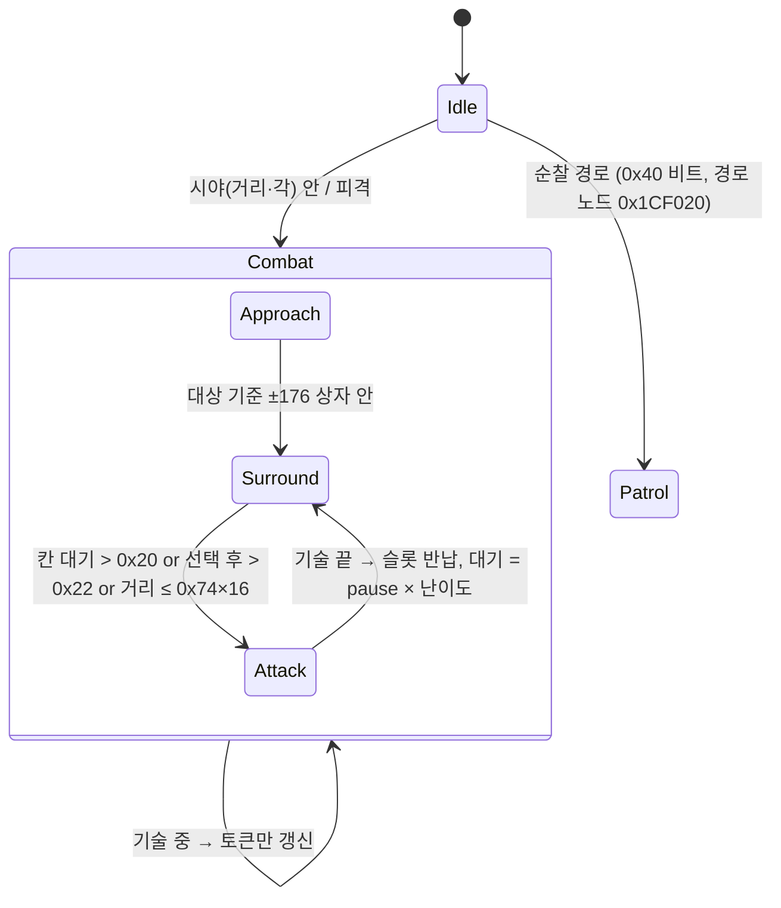

# 17. 적 AI (병사 AI · 결정 트리 · 공격 토큰 · 포위 이동 · 방어)

대상: 일반 적 `Enemy1`(0x22CA30) 의 AI 컴포넌트. 근거는 실행 파일 디스어셈블리(`work/exe/SCKA.asm`)와 전 WAD 의 TWK 데이터.
산출물: `work/ai/` — `ai1_raw.txt`(AI1 원시값), `ai1_table.txt`(형 해석 표), `dtre_raw.txt`/`dtre_all.txt`(결정 트리 73개 디코딩),
`blockmod_raw.txt`, `sold_raw.txt`, `scratch-scripts/`(VU0 매크로 해독 `vu0.py`, `dtre.py`, `ai1tab.py`, `sold.py` 등).
구현: [32-impl-enemy-ai](32-impl-enemy-ai.md).

## 0. 요약
- **적 의사결정은 데이터다.** AI1 템플릿(수치) + `TWK_DTre_NNN`(결정 트리 블록) + `TWK_Sold_NNN`(병사 구조체) + `BlockMod`.
  C++ 코드(0x1C0000–0x1D4000)는 공통 엔진: 인지 → 공격 토큰 → 포위 칸 이동 → 결정 트리 평가 → 가중 공격 선택.
- **공격 토큰**(확실): 대상(크라토스) 슬롯에 예산이 있고, 적은 `Sold +0x244`(비용)만큼 차지한다. 크라토스 용량 12 →
  해골(4) 3명, 미노타우르스(2) 6명, 사이클롭스(0) 무제한. 토큰 없는 적은 바깥 반경에서 대기하며 "비용 0" 행동(도발)만 한다.
- **동시 공격 수**(확실): 결정 트리 공격 항목마다 비용 A/B, 대상 용량 A/B(크라토스 10/10). 해골 공격(비용 3) 최대 3회 동시.
- **방어**(확실): 접촉 직전에 owner 콜백 → ① BlockMod(영웅이 같은 기술을 40초 안에 반복한 횟수로 학습) ② `rand×100 ≤ Block`
  이면 결정 트리 행동 노드의 방어 목록에서 기술 선택.
- **난이도**(확실): `AI Recovery Time Mult`(Easy 2 / Normal 1 / Hard 0.75 / Impossible 0.5)가 공격 후 대기·재사용 대기에 곱해진다.

## 1. 함수 지도
| 주소 | 이름(부여) | 내용 | 신뢰도 |
|---|---|---|---|
| 0x18B650 | AI_RegisterTweaks | AI1 템플릿 등록 (형/오프셋 표 §2) | 확실 |
| 0x1CEBA0 | AI_Init | 템플릿 → AI ctx(+0x24), HP/MaxHP, 크기, 토큰 플래그 | 확실 |
| 0x1D0E08 | AI_Update | 매 프레임: 대기 타이머, 상태 비트(+0x72) 분기, 토큰, 공격/포위 | 확실 |
| 0x1D30D0 | AI_SetTarget | 대상 교체: 이전 토큰 반납, 새 대상 토큰 시도 | 확실 |
| 0x1CDEC8 | AI_UpdateToken | 토큰 획득/반납 (§4) | 확실 |
| 0x1CE2E0 | AI_CombatMove | 반경 선택(토큰 유무), 격자 상자 안이면 포위, 밖이면 직접 접근 | 확실 |
| 0x1CD788 | AI_Surround | 11×11 칸 선택·타이머·공격 시도 (§5) | 확실(칸 선택 0x20AF30/0x20BA60 내부는 추정) |
| 0x1CC980 | AI_TryAttack | 결정 트리 → 공격 선택 → Combat_RequestAction | 확실 |
| 0x1CB930 | AI_CanAttack | 대기 타이머(+0x78)=0, 기술 중 아님 | 확실 |
| 0x1D2FB0 | AI_EndAttack | 공격 슬롯 반납, 대기 = pause × 난이도 배율 | 확실 |
| 0x1CBFF8 | AI_OnIncomingAttack | BlockMod + Block% 방어 (vtable 0x2BAFF4) | 확실 |
| 0x1CC610 | AI_OnIncoming2 | 보조 방어 확률(+0x6C) (vtable 0x2BAFFC, 호출 경로 미상) | 추정 |
| 0x1D22B0 | AI_Perceive | 시야 거리·각 (+0x4C/+0x50) | 추정(세부 미분석) |
| 0x1A1CF8 | DTre_Parse | 결정 트리 블록 파서 | 확실 |
| 0x1A2250 | DTre_Evaluate | 판단 노드 순회 | 확실 |
| 0x2296E0 | DTreLeaf_Parse | 행동 노드(공격/방어/보조 목록) | 확실 |
| 0x229258 | DTreLeaf_PickAttack | 거리·비용·재사용 조건 가중 선택 | 확실 |
| 0x229660 | DTreLeaf_PickBlock | % 누적 선택 | 확실 |
| 0x235248 (→0x2361AC) | 조건 함수 표 등록 | 0x2FFC68: 16바이트 × 28 (+4 함수, +0xC 형) | 확실 |
| 0x200000–0x200180 | TargetSlot_* | 대상 슬롯 초기화(Sold +0x248/+0x24A), 예산 검사 | 확실 |
| 0x1DC780 / 0x1DC9A8 / 0x1DC8F8 | PlayerMoveHistory_Add/Tick/Count | 영웅 기술 사용 기록 (0x3044D0) | 확실 |
| 0x203248 | Combat_AskOwnerBlock | OnContact(0x204124)·투사체(0x190F00)에서 owner 방어 콜백 | 확실 |

## 2. AI1 템플릿 필드 표 (`/TweakTemplates/AI1/NNN/`)
등록 함수의 a3−a2 = 템플릿 구조체 오프셋. 이진 TWK 0x20 레코드는 필드 크기만큼만 복사되므로 short/byte/bool 은 **하위 바이트만 유효**
(상위 바이트는 이전 float 쓰레기 — `3F800004` 의 u16 = 4). 이름: 사전 일치 = 이름, 해시만 = 이번에 붙인 이름.

| 오프셋 | 형 | 해시 / 사전 이름 | 이번 분석의 의미 | 사용처 | 예 (해골 020 / 미노 050) | 신뢰도 |
|---|---|---|---|---|---|---|
| 0x20 | u16 | a3c5272c | **칸 대기 시간(ms)**: 칸에 머문 시간이 이보다 길면 공격 시도 | 0x1CDA78 | 2000 / 500 | 확실 |
| 0x22 | u16 | b36ff1c2 | **칸 선택 후 공격 시도·토큰 보유 재배치 시간(ms)** | 0x1CDA8C | 2000 / 2000 | 확실 |
| 0x24 | u16 | 41e08a53 | **토큰 없을 때 재배치 시간(ms)** | 0x1CDA68 | 5000 / 3000 | 확실 |
| 0x26 | s16 | e9b40e3d | **BlockMod 번호** (-1 없음) | 0x1CC040 | 20 / 50 | 확실 |
| 0x28 | int | SoldierTemplate | TWK_Sold 번호 | 0x1CEC28 | 20 / 50 | 확실 |
| 0x2C / 0x30 | int | HitPoints / MaxHitPoints(5938a592) | HP, 최대 = max(둘) | 0x1CEE48 | 35 / 90 | 확실 |
| 0x34 | f32 | Damage Multiplier | 공격 피해 배율 | 0x1D3EA4 | 1 | 확실 |
| 0x38 | bits | Climb/Fly/Swim/Jump/Rope… | 이동 능력 | 0x1D0860 | | 확실(값) |
| 0x3C | int | c086e0b4 (DecisionTreeTemplate) | TWK_DTre 번호 | 0x1CEBxx | 20 / 50 | 확실 |
| 0x40 | int | b5134762 | 5000 — 0x1D38E8 에서 사용 (미상) | 0x1D3940 | 5000 | 미상 |
| 0x44 | s16 | AI Mode | 0 보병(토큰·포위), 1 직접 공격, 2 궁수, 3/4 변형(토큰 사용), 5 무반응(대상 지정 안 함) | 0x1D0E08 등 21곳 | 0 / 0 | 확실(분기) / 추정(이름) |
| 0x48 | f32 | 400232ce | 10 — 주변 개체 질의 반경(×16?) | 0x1D1B70 | 10 | 추정 |
| 0x4C | f32 | 4672bfb2 | **시야 거리(×16)** | 0x1D2318 | 90 / 80 | 추정 |
| 0x50 | f32 | d37b884c | **시야 반각(도)** cos(값°) 비교, 180 = 전방위 | 0x1D27E8 | 180 | 추정 |
| 0x54 | f32 | 79721b17 ("jq KI" 오탐) | 1.25 (×16) 이동 시 높이 오프셋 | 0x1CFC54 | 1.25 | 추정 |
| 0x58 | f32 | 4949c244 | 80 (×16) 거리 한계 판정 | 0x1D09FC | 80 | 추정 |
| 0x5C / 0x60 | f32 | ScaleRange / ScaleCenter | 크기 = C/100 + R/100 × (0.5 − rand) | 0x1CEE00 | 87 / 120 | 확실 |
| 0x64 / 0x68 | f32 | cd7da53a / 72949419 | 이동 속도 % (특수 상태 / 평상) | 0x1D0044 | 50 / 100 | 추정 |
| 0x6C | f32 | a7082db6 | 보조 방어 확률 % (0x1CC610) | AI ctx+0x64 | 0 / 2 | 확실(값)·추정(용도) |
| 0x70 | f32 | Block | **방어 확률 %** | AI ctx+0x68 → 0x1CC570 | 0 / 40 | 확실 |
| 0x74 | f32 | c3a12b87 | **즉시 공격 거리(×16)**: 이 안이면 대기 시간 무관하게 공격 시도 (-1 없음) | 0x1CDAA8 | -1 / 2.5 | 확실 |
| 0x78 | f32 | 2c2b1e13 | **재배치 최소 거리(×16)**: 대상과 이보다 멀어야 칸 재선택 | 0x1D3DA8 | 4 | 확실 |
| 0x7C | f32 | 62d4f60b | 0.5 (0x1CCD48 접근자, 0x2651E0 에서 사용) | | 0.5 | 미상 |
| 0x84 | bits | 7ea1ec2e(1) SwitchView(4) bbbc439a(8) dbb472c3(2) fc037268(0x40→ctx+0x48\|4) **cb247958(0x100 = 공격 토큰 사용)** 55637e92(0x80) Ignore Hits(0x200) 500a656c(0x400) 8eb6af1b(0x10 → 몸체 종류 2) ff0daf8f(0x800) 918de416(0x1000) | | 0x1CEED8 등 | | 0x100 확실 |
| 0x88 / 0x8A | u16 | PauseTime(9cdc15e3) / a2c359e9 | 3000/8000, 1000 ms — 이동 중 타이머(0x1CF894) | | 3000 / 1000 | 추정 |
| 0x8C–0x92 | u16 | cf615f41 / Search Move / 9789b6a5 / e752e4cf | 기술 ID (65535 없음) | 0x1D3B88 | 65535 | 추정 |
| 0x94 | u16 | b9ffcbe2 | **토큰 보유 포위 반경(×16)** | 0x1CE4BC | 4 → 64 단위 | 확실 |
| 0x96 | u16 | 758cabee | **대기 반경(×16)** = 토큰 획득 ×1.1 / 반납 ×1.5 / 도발 최소 ×0.75 | 0x1CDF58 등 5곳 | 10 → 160 | 확실 |
| 0x98 | u8 | d4521fd9 | 100 (%/100 이동 보간) | 0x1D02BC | 100 | 추정 |
| 0x99 | u8 | Away Mult | 75/30 — 사용처 미발견 | | 75 / 30 | 미상 |
| 0x9A | u8 | 1a55ba55 | 30 | 0x1CBFA4 | 30 | 미상 |
| 0x9B | s8 | f3a51122 | 플래그 HUD 적 표시 슬롯 등 | 0x1D0FD4 | 0 | 추정 |
| 0x9C / 0x9E | s16 | 0000247b / Level | | | 20 / 0 | 미상 |

전 템플릿 값: `work/ai/ai1_table.txt` (101개). 주의: 사전의 "AI Mode", "Search Move", "Away Mult", "jq KI" 는 2단어 조합 추정 이름이며
"jq KI" 는 명백한 오탐이다.

## 3. 결정 트리 (`TWK_DTre_NNN` "DecisionTree" 블록)
### 3.1 포맷 [확실 — 0x1A1CF8, 0x2296E0]
```
['#']           있으면 신형: 공격 항목에 u16 재사용 대기 추가
u32 노드 수
노드: u8 종류
  0 판단: u16 조건, u8 비교(0 == 1 != 2 < 3 <= 4 > 5 >=), u8 인자, u32 값, u16 참 → 노드, u16 거짓 → 노드
  1 행동: cstr 이름(≤16)
          u8 n × 공격 { s16 기술, f32 가중치, u16 최소거리, u16 최대거리, u16 비용A, u16 비용B, u16 공격 후 대기 ms, ['#': u16 재사용 대기 ms] }
          u8 n × 방어 { s16 기술, f32 % }
          u8 n × 보조 { s16 기술, f32 % }   (사용처 미발견)
```
거리 = 값/100 × 16 월드 단위 (해골 SKU3HIT 최대 500 → 80 단위). 기술 ID = Combat_RequestAction 의 루트 액션 ID(적은 A_n → M_n).
평가(0x1A2250): 값 형은 조건 표 +0xC — 0 float(<,<=,>,>=), 1·2 정수 등식, 3 정수 대소(점프표 0x2B5730).

### 3.2 조건 표 (0x2FFC68) [함수 확실 / 의미 이름은 해독]
| # | 함수 | 형 | 값 |
|---|---|---|---|
| 0 | 0x1A1150 | f | 대상 방향의 앙각(도) |
| 1 | 0x1A1318 | f | 정면 기준 대상 방위각(도, 부호 = 좌우) |
| 2 | 0x1A1408 | f | 3D 거리 / 16 |
| 3, 6 | 0x1A1450, 0x1A14F8 | b | 항상 0 (흔적) |
| 4 / 5 | 0x1A14B8 / 0x1A14D8 | e | 자신/대상 상태: 0 지상, 1 벽(0x20), 2 공중(0x4), 3 로프(0x400) |
| 7 | 0x1A1528 | b | 대상이 정면(d·Z < 0) |
| 8 | 0x1A15D8 | b | 대상이 한쪽(d·X < 0) |
| 9 / 10 | 0x1A1640 / 0x1A1660 | f | 자신/대상 HP 비율 |
| 11 | 0x1A1680 | b | 대상이 방어 자세(현재 기술 +0x13 == 1) |
| 12 | 0x1A1580 | b | 대상이 위(d·Y > 0) |
| 13 / 14 / 15 | 0x1A12C0 / 0x1A1210 / 0x1A1270 | f | 측면 / 전방 / 높이 차 (÷16) |
| 16 | 0x1A16D0 | b | 대상이 바로 위(위 + 측·전방 \|·\| < 8) |
| 17 | 0x1A1778 | b | 대상 정지(속도 < 0.01) |
| 18 | 0x1A17C0 | b | 대상이 기술 중 |
| 19 | 0x1A17F0 | f | 수평 거리 / 16 |
| 20 | 0x1A1850 | f | 대상 시점의 자신 방위각 |
| 21 | 0x1A1938 | b | 자신 상태 비트 & 0x4C |
| 22 | 0x1A1948 | b | 반경(×16) 충돌 질의 |
| 23 | 0x1A19B0 | i | 대상 현재 기술 ID (-1) |
| 24 | 0x1A1A08 | b | **공격 토큰 보유** (자기 슬롯 +0x16 bit2 == 0) |
| 25 | 0x1A1A80 | b | 스크립트/레벨 변수 (인자 = 이름 해시) |
| 26 / 27 | 0x1A1B18 / 0x1A1B28 | i | 전역 0x29DC1C +0x88 / +0x64 |

### 3.3 실제 트리 (`work/ai/dtre_all.txt`, 73개)
일반 적 대부분은 `if 토큰 보유 → [attack!] else [taunt!]`.
```
DTre_050 미노타우르스:  0: hasToken == 1 ? 1 : 2
  1 [attack!] 10 AXEATTACK2 w20 0..96 비용A 5 / 11 AXECOMBO w20 0..96 비용A 3 대기 1000ms   방어 17 BLOCK 100%
  2 [taunt!]  0 TAUNT w100, 2 TAUNT03 w100  0..320 비용 0                                     방어 17 100%
DTre_020 해골 Lv1:      [attack!] 12 도약 w0 32..80 / 11 SKU3HIT w100 0..80 비용A 3 대기 2000ms  방어 10   [taunt!] 0/1/2 w33
DTre_021 해골 -C(벽):   대상 벽 & 자신 벽 → 높이 > 2 이면 attack up!(17) / < -1.5 attack down!(18) / 좌·우(15/16),
                         대상 로프 & 자신 로프 → rope attack!, 자신 벽 → get the hero!, … 마지막에 attack!/taunt!
```
보스·특수 적은 "Zone 1–4", "shoot her!", "heal!", "back off!" 등 이름이 붙은 행동을 가진다.

## 4. 공격 토큰과 공격 슬롯 [확실]
대상 슬롯 구조체(엔티티 vtable+0x78): `+0x0C 예산, +0x0E/+0x10 사용 A/B, +0x12/+0x14 용량 A/B (=Sold +0x248/+0x24A), +0x16 플래그`.
```
// AI_UpdateToken 0x1CDEC8 (템플릿 0x84&0x100 이고 AI Mode ∈ {0,3,4})
R = tmpl[0x96] * 16
if (!보유) { if (dist < R*1.1 && 자신 경직(guard 2) 아님 && 대상 경직 아님 && 대상.예산 + 내Sold[0x244] ≤ 대상Sold[0x246]) 보유, 예산 += 비용 }
else if (dist > R*1.5 || 자신 경직 || 대상 경직) { 반납, 예산 -= 비용, 칸 = 없음 }
```
TWK_Sold 값 (`work/ai/sold_raw.txt`): 크라토스 000 = 비용 4, **용량 12, A 10, B 10**. 해골 4, 미노 2, 케르베로스 2, 새끼 1,
다이버 6, 사이클롭스·궁수(SK2/SK3) 0. → 토큰 보유 상한: 해골 3, 미노 6.
공격 시(0x1CCC74): 대상 사용A += 비용A, 사용B += 비용B. 자격은 `비용A ≤ 용량A − 사용A` (토큰이 없고 Mode≠1 이면 여유 A = 0 →
비용 0 행동만). 공격 끝(0x1D2FB0)에 반납.

## 5. 상태 기계와 포위 이동 [확실 — 0x1D0E08, 0x1CE2E0, 0x1CD788]

- 반경: 토큰 보유 `tmpl[0x94]×16`(64), 없음 `tmpl[0x96]×16`(160). 대상 주변 11×11 칸(32 단위, ±160)에서 반경에 가까운 빈 칸 선택.
- 타이머: ai+0x7A 칸 선택 후 경과(항상 증가), ai+0x76 칸 도착 후(칸 밖이면 0).
- 토큰 보유: 공격 시도 → 성공하면 칸 해제. 실패 + 거리 > 0x78×16 + 선택 후 ≥ 0x22 → 새 칸.
- 토큰 없음: 거리 ≥ 0.75 × 대기 반경일 때만 시도(= 도발 등 비용 0 행동).
- AI Mode 1/2: 포위 없이 매 프레임 공격 시도. Mode 5: 대상 지정 자체를 안 함.

## 6. 공격 선택 공식 [확실 — 0x229258, 0x1CC980]
```
if (ai.대기ms > 0 || 기술 중) 실패
leaf = DTre.evaluate()
freeA = (토큰 보유 || Mode == 1) ? 용량A − 사용A : 0;  freeB = 용량B − 사용B
자격(e) = min×0.16 < dist < max×0.16 && e.비용A ≤ freeA && e.비용B ≤ freeB && (e.재사용 == 0 || 행동노드 대기 끝)
e = 가중치 비례 무작위(자격 항목)
if (e.재사용 > 0) 행동노드 대기 = now + e.재사용 × RecoveryMult
Combat_RequestAction(e.기술);  ai.대기ms = e.pause × RecoveryMult    // 0x1CCCD8 (난이도 표 0x337728 +8)
```

## 7. 방어 [확실 — 0x204124, 0x203248, 0x1CBFF8]
조건: 피격자가 이미 방어 자세(+0x13 == 1)가 아니고, NO_BLOCK(0x1AC & 0x40)이 아니고, 공격 기술 flags & 2(방어 불가)가 아님.
```
// 영웅 공격일 때만: BlockMod[i] (Move i, Min, Min Block, Limit), i = 0..9
n = 영웅기록.count(공격 기술)          // 기술 시작마다 +1, 타이머 40000 갱신, 6칸 (0x1DC780)
if (n ≥ Limit)  → 방어 목록에서 선택해 요청 (강제)
else if (n > Min) → 확률 = MinBlock + (100 − MinBlock) × (n − Min)/(Limit − Min)
// 일반
if (rand×100 ≤ Block) → 행동 노드 방어 목록(%) 에서 선택해 요청
```
예 BlockMod 050(미노): 영웅 기술 7(BLOCKLAUNCHER) Min 3 / 50% / Limit 9, 13·11·6·16 Min 3 / 50% / Limit 6.
BlockMod 020(해골)과 050 의 0번 항목은 Move 0 / Limit 0 이라 영웅 기술 0(COMBO7A)은 항상 방어 시도 대상이다(데이터 그대로).
투사체는 두 번째 표(+0x5C 2개, 해시 eb8316bf…)와 별도 기록(타이머 60000)으로 같은 계산.

## 8. 미해결
1. 칸 선택 함수 0x20AF30 / 0x20BA60 의 정확한 비용(점유 비트 +0x50/+0x60 은 확인).
2. 인지(0x1D22B0) 세부: 시야 가림, 경보 반경(0x48), 대상 상실 조건(0x58).
3. 보조 목록(+0x20)·보조 방어(0x6C, 0x1CC610)의 호출 경로.
4. 이동 속도: 적 걷기 클립은 제자리 루프라 zeroJoint 이동량이 0 — 원작 이동 속도 출처 미확인 (구현은 발 미끄럼으로 추정).
   - 검토(가설 기각 보류): 애니 트윅 `<클립>_Cycle` (sub_00116BB0 → 애니 항목 +0x14, 미노 walkFront 3.0 / runFront 5.0, 해골 run 8.5,
     사이클롭스 walk 2.5 / run 5.0) 을 "루프 1회 이동 거리(m)" 로 보면 걷기 3.0×16/1.467s = 32.7 (발 미끄럼 28.4) 로 맞지만
     달리기 5.0×16/0.733 = 109 (미끄럼 156), 해골 달리기 146 (53) 로 어긋난다 → +0x14 를 읽는 쪽 분석 전까지 미채택.
5. 순찰(Patrol%d / 경로 노드 0x1D4AA0) 상세, AI Mode 2(궁수)·3·4 차이.
